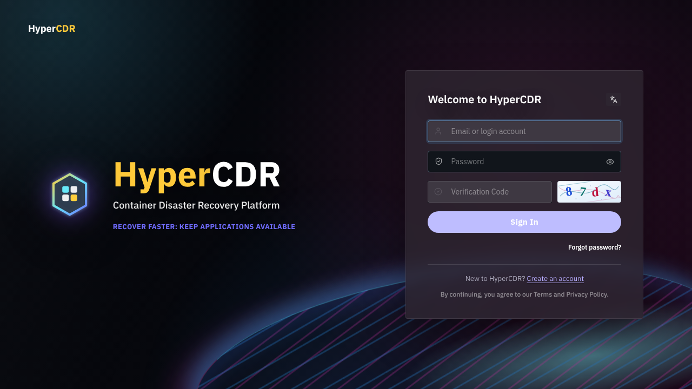

# 文档图片资源

本目录集中存放随 HyperCDR 文档发布的图片，避免图片文件散落在 Markdown 文档目录中。

## 目录约定

- `overview/`：产品概览、架构和能力说明图片。
- `installation/`：安装、配置和验收图片。
- `user-guide/`：登录、集群、保护、恢复和运维页面图片。

当前已收录的实机截图：`overview/login-149.png`。该图只展示登录入口，不代表生产环境的地址、证书或认证配置。

Markdown 文档使用相对路径引用图片，例如：

```markdown

```

提交前应遮盖密码、Token、邮箱、内网地址和其他敏感信息。149 环境临时截图如果不作为仓库资产发布，应保存在本地核验证据目录，不要放入本目录。
