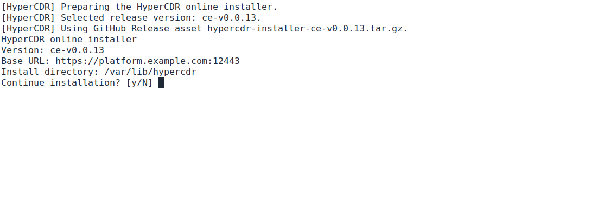
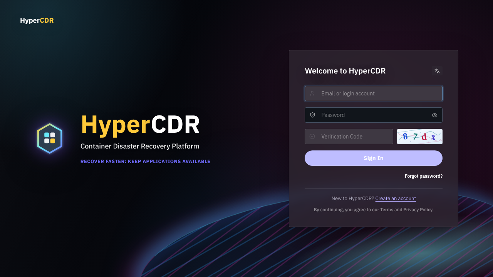
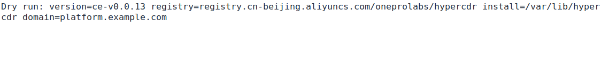
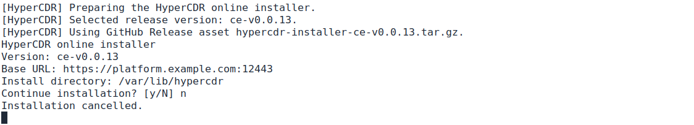

# HyperCDR 产品安装

本文面向负责部署和维护中控平台的管理员，介绍安装前准备、在线与本地包安装、登录配置、验收、升级、回滚和卸载。安装完成后，请继续阅读[用户使用手册](../user-guide/product-user-manual.zh.md)，注册集群并配置应用保护；安装中控不会自动保护业务应用。

本文的中控部署方式是独立 Linux 主机上的 Docker Compose。示例使用 HTTPS 域名和默认安装目录；请替换为现场规划。需要先判断是否适用于目标集群与存储环境时，请阅读[产品概览](../product-overview.zh.md)和[适配范围](support-scope.zh.md)。本地安装包不等于完全离线镜像包，具体边界见第 6 节。

## 目录

- [1. 安装前准备](#1-安装前准备)
- [2. 在线安装](#2-在线安装)
- [3. 安装参数](#3-安装参数)
- [4. 验证码和登录](#4-验证码和登录)
- [5. 安装后验收](#5-安装后验收)
- [6. 离线/本地安装](#6-离线本地安装)
- [7. 平台维护：升级、回滚和卸载](#7-平台维护升级回滚和卸载)
- [8. 常见问题](#8-常见问题)
- [9. 安装产物、服务与目录](#9-安装产物服务与目录)
- [10. 完整配置参考](#10-完整配置参考)
- [11. 安装后逐项验收](#11-安装后逐项验收)
- [12. 平台页面升级与维护边界](#12-平台页面升级与维护边界)
- [13. 安装故障定位](#13-安装故障定位)
- [14. 安装界面与结果判读](#14-安装界面与结果判读)

## 1. 安装前准备

### 1.1 主机要求

Linux 主机需要预先安装：

- Docker Engine；
- Docker Compose v2（`docker compose`）；
- Bash、curl、tar、OpenSSL；
- `jq`（版本清单校验及回滚使用）；
- 建议准备 `flock`（通常由 util-linux 提供，用于部署锁）。

安装器不会自动安装 Docker，也不会安装 Harbor、Nginx Proxy Manager 或外部对象存储。

### 安装器会检查什么

| 条件 | 当前检查与用户责任 |
| --- | --- |
| 在线入口依赖 | 检查 curl、tar、Docker 命令及 root 权限；缺少时退出 |
| 实际部署依赖 | 检查 Docker、OpenSSL、install 和 Compose v2；其他运行依赖仍应预先准备 |
| 版本与参数 | 部署程序验证版本格式、HTTPS 地址前缀、镜像仓库及绝对安装目录 |
| Docker 服务、镜像访问 | 命令存在不代表服务可用，连接与拉取还需实际成功 |
| CPU、内存和磁盘容量 | 该在线入口不保证全面检测；部署前由管理员按规模评估并预留升级空间 |
| DNS、端口、防火墙和证书 | 需管理员准备并验证，不会自动完成外部网络配置 |
| Cloudflare 允许清单 | 通过交互询问用户确认，不向 Cloudflare 查询或自动登记 |

不要把“安装前检查未报错”理解为容量、外网、所有集群连接和业务恢复均满足要求。`jq` 等依赖在后续步骤才可能使用，仍须提前准备，不能因为入口未逐项检查就省略。

### 1.2 网络要求

| 方向 | 用途 |
| --- | --- |
| 安装主机 → GitHub | 获取入口脚本、Release 安装包和校验文件。 |
| 安装主机 → 镜像仓库 | 拉取 API、前端、注册执行器及依赖镜像。 |
| 浏览器 → 中控主机 `12443/tcp` | 访问登录页和 API。 |
| 集群 Agent → 中控 `12443/tcp` | 建立 HTTPS/WSS 出站连接。 |
| Agent/集群组件 → 对象存储 | 写入和读取备份数据。 |
| 注册执行器 → Kubernetes API | 使用 Install for me 注册集群。 |

数据库、API、前端和注册执行器不直接发布宿主机端口。安装产品门户时另使用 `12445/tcp`。

### 1.3 地址和证书

`--base-url` 必须是浏览器和集群 Agent 都能访问的 HTTPS Origin，例如：

```text
https://platform.example.com:12443
```

可以使用 IP，但正式环境建议使用 DNS 名称和受信任证书。安装器生成的 TLS 证书不会自动受到浏览器信任；证书名称、访问地址和反向代理配置必须一致。

## 2. 在线安装

### 功能说明

在线安装从公开发布位置获取所选版本的安装包，并在指定 Linux 主机部署中控平台。集群 Agent 在中控安装完成后，通过集群注册流程单独安装；本步骤不会将业务集群自动纳入保护。

### 前置条件

- 已完成第 1 节的主机、网络、地址和证书准备。
- 当前用户能够使用 `sudo`，且 Docker 服务已启动。
- 首次安装使用独立目录；已有平台升级不要按全新安装处理，也不要先删除数据。
- 已确定登录验证码方式；未登记 Cloudflare 允许主机或内网无法访问 Cloudflare 时，选择图片验证码。

### 操作步骤与向导说明

1. 执行下面的安装命令，替换示例域名，不需要安装产品门户时不要添加 `--install-website`。
2. 等待入口脚本下载。脚本启动后输出准备信息；没有指定版本时先解析最新 Release，再显示 **Selected release version**。记录该版本，后续问题定位应使用实际版本而不是“最新版”。
3. 在摘要中核对 **Version**、**Base URL**、**Install directory**。出现 `Continue installation? [y/N]` 时，输入 `y` 并回车才继续；回车或输入其他内容会取消安装，不代表部署成功。
4. 等待版本安装包下载与解压。下载过程显示进度，网络等待与容器镜像拉取是不同阶段；不要因为短暂无输出而重复启动安装器。
5. 若安装包具有完整 Turnstile 凭据且使用自动认证选择，按提示确认当前主机是否已登记 Cloudflare。选择否或不确定时使用图片验证码；该问题是用户确认，不是安装器查询了 Cloudflare 允许清单。
6. 等待安装包内的部署程序检查依赖、准备配置并启动平台。缺少 Docker 或 Compose v2 等条件时，按错误补齐后重试，不要忽略错误继续验收。
7. 按第 5 节完成服务与浏览器验收，再进入使用手册注册集群、配置存储和验证最小保护流程。



图为 149 上实际运行入口脚本、指定版本后停在确认提示的界面。此时尚未下载版本包或部署平台；截图使用示例域名，不能直接作为实际访问地址。需安装时输入 `y`；只检查信息时输入 `n` 取消。

### 字段与页面说明

| 向导信息 | 用户需要核对的内容 |
| --- | --- |
| Version | 本次实际安装的 Release 版本；不指定版本并不代表没有版本 |
| Base URL | 浏览器与集群 Agent 均可访问的中控 HTTPS 地址 |
| Install directory | 保存平台配置和部署辅助脚本的位置 |
| Continue installation | 首次安装确认；自动化执行可用 `--yes` 跳过 |
| Cloudflare 允许主机确认 | 确认访问主机是否登记，不会自动登记，也不检测允许清单 |

### 结果确认

必须同时确认安装命令无错误结束、平台服务启动、`/readyz` 可用、浏览器登录成功。仅下载完成或出现版本摘要不是安装成功；登录成功也不代表集群备份与恢复已经验收。

### 注意事项与常见问题

- 管道命令中的 `curl` 下载脚本并交给 Bash 执行，不会把脚本保存到当前目录。
- 不带 `--yes` 时需要可交互终端；从管道执行时，确认问题通过 `/dev/tty` 读取，不要把回复直接拼接到脚本输入中。
- DNS、TLS 或下载失败时保留具体错误及实际版本。先处理网络问题，不要用关闭认证或删除数据库的方式解决下载故障。

### 2.1 安装最新正式版

```bash
curl -fL --progress-bar \
  https://raw.githubusercontent.com/oneprolabs/hypercdr/main/deploy/online/install.sh \
  | sudo bash -s -- \
    --base-url https://platform.example.com:12443 \
    --install-dir /var/lib/hypercdr
```

安装器会显示解析到的实际版本、地址和安装目录。交互安装会询问是否继续；管道方式也会从 `/dev/tty` 读取回答。

### 2.2 固定版本安装

生产环境和问题复现建议固定版本：

```bash
curl -fL --progress-bar \
  https://raw.githubusercontent.com/oneprolabs/hypercdr/main/deploy/online/install.sh \
  | sudo bash -s -- \
    --version ce-v0.0.13 \
    --base-url https://platform.example.com:12443 \
    --install-dir /var/lib/hypercdr
```

不带版本时，入口从 GitHub Release 的固定 `latest.json` Asset 获取版本，不依赖 GitHub API；指定版本时直接下载对应 Release Asset。

### 2.3 非交互安装

```bash
curl -fL --progress-bar \
  https://raw.githubusercontent.com/oneprolabs/hypercdr/main/deploy/online/install.sh \
  | sudo bash -s -- \
    --base-url https://platform.example.com:12443 \
    --install-dir /var/lib/hypercdr \
    --auth-challenge image \
    --yes
```

`--yes` 会跳过确认，并默认选择图片验证码；建议在自动化环境显式指定 `--auth-challenge image` 或 `turnstile`。

## 3. 安装参数

| 参数 | 必需 | 说明 |
| --- | ---: | --- |
| `--base-url URL` | 是 | 中控对外 HTTPS Origin，默认入口端口为 `12443`。 |
| `--version VERSION` | 否 | Release 版本，如 `ce-v0.0.13`；不填使用最新正式版。 |
| `--install-dir PATH` | 否 | 安装目录，默认 `/var/lib/hypercdr`。 |
| `--registry REGISTRY` | 否 | 覆盖默认镜像仓库。 |
| `--install-website` | 否 | 同时安装可选产品门户，使用 `12445`。 |
| `--public-base-url URL` | 否 | 兼容参数；当前安装流程以 `--base-url` 为主要地址，不应依赖此参数改变平台设置。 |
| `--auth-challenge MODE` | 否 | `auto`、`image` 或 `turnstile`。 |
| `--yes` | 否 | 跳过安装确认。 |

## 4. 验证码和登录

### 功能说明

登录挑战用于保护账号登录。可选择本地图片验证码或 Cloudflare Turnstile；两者是安装配置选择，不是运行时自动故障切换关系。

### 前置条件

已规划实际访问主机。使用 Turnstile 时，准备有效的成对凭据、允许主机登记，以及浏览器和服务端到 Cloudflare 的网络；不具备这些条件时使用图片验证码。

### 操作步骤

1. 交互安装使用默认 `auto`，在认证提示出现时如实确认允许主机登记情况。
2. 未登记、不确定或无法满足网络条件时选择图片验证码；自动化安装可显式指定 `--auth-challenge image`。
3. 需要强制 Turnstile 时使用 `--auth-challenge turnstile`，并确认部署已具备完整凭据。不要把登记回答当成凭据配置。
4. 安装后打开登录页，检查实际挑战方式并完成一次登录。

### 字段与页面说明

Release 包可携带 Turnstile Site Key 和 Secret Key。交互安装选择 `auto` 时，如果凭据完整，会询问当前访问主机/IP 是否已加入 Turnstile 允许主机列表：

- 选择 `y`：使用 Cloudflare Turnstile；
- 选择 `n` 或直接回车：使用内置图片验证码；
- `--auth-challenge image`：强制图片验证码；
- `--auth-challenge turnstile`：强制 Turnstile，缺少完整凭据时安装失败。

### 结果确认

登录页显示预期挑战方式，验证和登录可完成；图片验证码为 4 位数字和字母，字母校验不区分大小写。不能只检查安装命令是否结束。

### 注意事项与常见问题

Cloudflare 运行时不可达不会自动切换图片验证码；需要由部署管理员在维护窗口调整 `.env` 并重建受影响容器或重新执行受控部署。不要通过公开 Secret Key 或关闭账号认证来排查问题。

## 5. 安装后验收

### 5.1 浏览器验收

#### 功能说明

确认用户可以通过产品地址打开登录入口，并使用安装时选择的认证方式登录。

#### 前置条件

`readyz` 返回 200，浏览器能访问 `12443/tcp`，TLS 证书和访问地址已经准备好。

#### 操作步骤

1. 打开 `https://<主机地址>:12443`。
2. 检查页面标题、地址栏和验证码区域。
3. 使用初始管理员登录，进入个人安全设置修改密码。



#### 字段与页面说明

| 检查对象 | 正常结果与边界 |
| --- | --- |
| 地址与证书 | 使用规划中的平台地址，证书名称和信任链符合部署要求 |
| 图片验证码或 Turnstile | 与安装选择一致，可以完成挑战 |
| 登录 | 有效账号可进入 Dashboard，不停留在错误或验证状态 |
| Compose 服务 | 当前活动 API、前端、Edge、数据库等必要服务正常，不要求未启用颜色也处于运行状态 |
| 就绪接口 | `/readyz` 返回 200；不代表业务集群、对象存储和恢复任务已验收 |

#### 结果确认

登录页加载完成、验证码可用、登录成功后能看到 Dashboard。此截图来自 149 开发环境；生产环境应替换为正式地址和受信任证书。

#### 注意事项与常见问题

集群注册、存储和任务页面还需要登录后的业务配置。平台登录成功不是业务保护完成，应继续执行第 11 节的逐项验收。

### 5.2 主机侧检查

在实际安装目录检查服务和就绪接口：

```bash
cd /var/lib/hypercdr
sudo docker compose --env-file .env -f docker-compose.yaml ps
sudo systemctl status hypercdr.service hypercdr-upgrade-runner.service --no-pager
curl -kfsS -o /dev/null -w 'ready=%{http_code}\n' https://platform.example.com:12443/readyz
```

然后从浏览器访问 `/login`，完成初始登录、修改密码、验证码验证，并检查 API、前端、PostgreSQL 和 Edge 容器均健康。`readyz` 通过不代表对象存储、Agent 注册或真实恢复任务已验证。

初始账号通常为 `admin`，初始密码为 `admin123`；首次登录后必须修改密码。

`systemctl` 命令仅适用于使用 systemd 的主机。示例中的 `curl -k` 仅用于隔离测试环境的自签名证书连通性检查，不验证证书信任；正式环境应安装受信任证书，并去掉 `-k` 再验证。

## 6. 离线/本地安装

### 功能说明

本地包安装适用于安装主机不能方便下载 GitHub Release、但能够访问镜像仓库的环境：先在联网主机下载版本包，再复制到目标主机执行。当前安装包包含脚本、配置模板和部署资产，**不是包含全部容器镜像的完全离线镜像包**。

### 前置条件

- 目标主机满足第 1 节要求，已准备 Docker、Compose v2、tar 和 `sha256sum`。
- 联网下载主机具备 GitHub CLI（`gh`），并能访问目标 Release；也可在 Release 页面下载同名资产。
- 目标主机能访问所选镜像仓库；仓库要求认证时，先按仓库规范完成 `docker login`。
- 确认版本、安装目录、访问地址和验证码方式。以下示例明确使用图片验证码，不依赖 Cloudflare 凭据或允许清单。

### 操作步骤

#### 步骤一：下载安装包

在联网主机下载同一版本的安装包和校验文件。示例版本需替换为实际选择的 Release：

```bash
VERSION=ce-v0.0.13
gh release download "$VERSION" -R oneprolabs/hypercdr \
  -p "hypercdr-installer-${VERSION}.tar.gz" \
  -p "hypercdr-installer-${VERSION}.sha256"
sha256sum -c "hypercdr-installer-${VERSION}.sha256"
```

#### 步骤二：校验与复制

检查校验输出为 `OK`。失败时重新下载，不解压执行。

将安装包和校验文件一并复制到目标主机，在目标端再次校验，再解压。重新设置 `VERSION`，不要假定下载主机上的变量会随文件复制过去。

```bash
VERSION=ce-v0.0.13
sha256sum -c "hypercdr-installer-${VERSION}.sha256"
tar -xzf hypercdr-installer-${VERSION}.tar.gz
cd hypercdr-installer-${VERSION}
```

#### 步骤三：预览参数

在解压目录先执行预览，核对版本、仓库、安装目录和域名。此命令没有 `--execute`，不会部署：

```bash
sudo env HCDR_AUTH_CHALLENGE_MODE=image ./install-blue-green.sh "$VERSION" \
  --base-url https://platform.example.com:12443 \
  --domain platform.example.com \
  --registry registry.cn-beijing.aliyuncs.com/oneprolabs/hypercdr \
  --install-dir /var/lib/hypercdr
```



图为 149 上实际运行本地安装器获得的预览。`Dry run` 只打印参数，不表示已检查所有依赖、拉取镜像或安装服务；图中换行由终端宽度产生，路径并未增加空格。

#### 步骤四：执行安装

核对预览后，在同一目录执行安装：

```bash
sudo env HCDR_AUTH_CHALLENGE_MODE=image ./install-blue-green.sh "$VERSION" \
  --base-url https://platform.example.com:12443 \
  --domain platform.example.com \
  --registry registry.cn-beijing.aliyuncs.com/oneprolabs/hypercdr \
  --install-dir /var/lib/hypercdr \
  --execute
```

离线安装仍需要目标主机能够访问配置的镜像仓库，除非镜像已提前导入并改用可访问的本地仓库。离线包不包含 Docker Engine，也不自动准备 Kubernetes 集群或对象存储。

### 参数与目录说明

| 对象或参数 | 说明 |
| --- | --- |
| `hypercdr-installer-${VERSION}` | 解压目录，不是持久化安装目录 |
| `--install-dir` | 平台持久化配置和部署辅助脚本目录，升级时保持一致 |
| `--registry` | 容器镜像来源，目标主机必须可访问且具备所需权限 |
| `HCDR_AUTH_CHALLENGE_MODE=image` | 本示例显式采用本地图片验证码 |
| `--execute` | 执行实际部署；不带时仅输出参数预览，不完成依赖或业务验收 |

### 结果确认

按第 5 节和第 11 节检查容器、就绪接口、实际版本和浏览器登录。出现 `Dry run` 只表示参数预览结束，不表示安装成功。

### 注意事项与常见问题

- 包可能包含部署凭据，限制压缩包、解压目录和校验文件的访问范围，不将配置内容粘贴到公开工单。
- 完全无外网时，还需单独准备所有版本匹配的镜像及仓库；不要只复制这个脚本包就宣称环境已具备完全离线部署条件。
- 如确需 Turnstile，应准备有效的成对凭据、允许主机和网络条件，并按受控部署配置执行；不要直接省略示例中的图片验证码选择。

## 7. 平台维护：升级、回滚和卸载

### 功能说明

平台升级用于更新中控服务；回滚用于在保留可用上一版本时恢复平台流量；卸载用于停止或移除当前中控安装。这些操作不等同于集群注销，也不自动升级或卸载已注册集群的 Agent。

### 前置条件

- 已确认操作的是目标中控主机及实际安装目录，安排维护窗口并停止新任务提交。
- 升级或回滚前记录当前版本、目标版本和集群组件版本，确认目标版本适用。
- 已按保留要求备份数据，并验证备份文件不在将要删除的安装目录中。
- 回滚要求上一版本的清单、镜像和部署状态仍可用；没有保留目标版本时不要将回滚命令视为恢复保障。

### 操作步骤：升级与回滚

升级前备份 PostgreSQL、`.env`、平台密钥、TLS 文件和版本清单。平台升级采用蓝绿部署，成功切换后检查活动版本、任务和 Agent 状态。回滚：

```bash
sudo /var/lib/hypercdr/deploy-blue-green.sh --rollback
```

回滚不撤销数据库迁移，也不自动回滚集群 Agent。

安装到自定义目录时，回滚脚本还需要使用相同的安装目录，例如：

```bash
sudo env HCDR_INSTALL_DIR=/srv/hypercdr /srv/hypercdr/deploy-blue-green.sh --rollback
```

不要把全新安装或删除数据库当作升级步骤。升级入口和版本选择参见第 12 节，升级完成后重新执行第 11 节验收。

### 操作步骤：卸载

1. 确认业务集群后续如何管理；如需移除集群端组件，先按使用手册评审集群注销，而不是假定中控卸载会代办。
2. 在实际安装目录运行预览，不带 `--execute` 不会执行删除：

   ```bash
   sudo /var/lib/hypercdr/uninstall.sh
   ```

3. 核对输出中的安装目录、目标容器、Purge data 和 Remove images。
4. 根据保留要求选择以下一种命令；不要两条都执行。

默认卸载保留数据：

```bash
sudo /var/lib/hypercdr/uninstall.sh --execute
```

彻底删除平台安装目录、数据库卷和平台镜像（不可恢复）：

```bash
sudo /var/lib/hypercdr/uninstall.sh --purge-data --remove-images --execute
```

这些命令不删除外部对象存储、业务集群、Harbor、MinIO 或其他无关服务。

### 参数与页面说明

| 选项 | 说明 |
| --- | --- |
| 不带 `--execute` | 仅打印卸载计划，用于核对范围 |
| `--execute` | 应用卸载操作，默认保留数据 |
| `--purge-data` | 配合执行参数删除此安装目录和平台数据，不能依靠目录内文件恢复 |
| `--remove-images` | 配合执行参数移除卸载范围内的平台镜像，不是清空宿主机全部镜像 |

卸载脚本按自身所在位置识别安装目录，不按当前终端目录识别。必须运行已安装目录内的脚本，不应从源码目录或解压包直接卸载线上平台。

### 结果确认

- 升级或回滚：入口可访问、服务就绪、实际活动版本符合预期，并确认已有集群和任务数据仍可查看。
- 保留数据卸载：目标平台容器已停止或移除，数据保留符合计划。停止容器不代表备份已完成。
- 彻底卸载：目标容器、平台数据和所选镜像按计划清除，无关服务未受影响。外部对象存储和业务集群的保留与清理由各自管理流程确认。

### 注意事项与常见问题

- 彻底删除不可逆；不要在没有备份或删除授权时添加 `--purge-data`。
- 不使用 `docker system prune` 或删除宿主机整个 Docker 数据目录代替产品卸载。
- 回滚平台版本不能撤销已经发生的集群资源恢复、接管、备份删除或数据库迁移。

## 8. 常见问题

- **入口下载卡住**：检查到 `raw.githubusercontent.com` 的 DNS、IPv4/IPv6 和 HTTPS 出口；用 `--version` 可减少版本发现步骤，但仍需下载 Release 资产。
- **返回 API 403**：新入口不应依赖 GitHub API；确认使用的是 `main` 上最新 `install.sh`。
- **镜像拉取失败**：检查 Registry 地址、凭据、DNS、代理和防火墙。
- **浏览器证书警告**：使用正式证书或将测试证书按组织安全策略导入信任库。
- **Agent 离线**：检查 Agent 到 `--base-url` 的 WSS 出站连通性、时间同步、Token 和集群网络策略。
- **任务失败**：先查看任务详情和详细日志，再核对 Agent、Kubernetes 权限、Velero/OADP、CSI 和对象存储访问。

## 9. 安装产物、服务与目录

典型安装目录为 `/var/lib/hypercdr`，实际文件以发布包版本为准：

| 路径/对象 | 作用 |
| --- | --- |
| `.env` | 地址、认证、数据库、密钥和镜像配置，必须保护权限 |
| `docker-compose.yaml` | 当前发布包的服务编排，与验收命令中的文件名一致 |
| PostgreSQL 数据卷 | 中控元数据和任务状态 |
| `tls.crt`、`tls.key` | 默认 Edge TLS 证书与私钥；如配置其他路径，以实际配置为准 |
| `releases/<版本>/release-manifest.json` | 按版本保存的发行清单及组件镜像身份 |
| `current-release.json` | 当前活动发行清单；升级切换后需核对实际版本 |
| `restart-platform.sh`、`configure-public-url.sh` | 重启和访问地址辅助脚本 |

平台通常由 Edge、蓝/绿 API、蓝/绿前端、PostgreSQL、注册执行器和升级执行器组成；可选产品门户独占 `12445`，不安装门户不影响中控 `12443`。

## 10. 完整配置参考

| 变量 | 说明 |
| --- | --- |
| `HCDR_BASE_URL` | 中控外部 HTTPS Origin，必须与 Agent WSS 地址一致 |
| `HCDR_PUBLIC_BASE_URL` | 首次初始化平台地址，已有数据库设置后不覆盖 |
| `HCDR_HTTPS_PORT` | Edge 端口，默认 `12443` |
| `HCDR_WEBSITE_PORT` | 可选门户端口，默认 `12445` |
| `HCDR_AUTH_CHALLENGE_MODE` | `captcha`/`image` 或 `turnstile` |
| `HCDR_TURNSTILE_SITE_KEY`、`HCDR_TURNSTILE_SECRET_KEY` | Turnstile 前后端凭据，必须成对配置 |
| `HCDR_DATABASE_URL` | PostgreSQL 连接地址 |
| `HCDR_SECRET_KEY` | 保护秘密字段的密钥，迁移必须保留 |
| `HCDR_IMAGE_REGISTRY` | 平台、Agent、Velero/OADP 镜像仓库 |
| `HCDR_TLS_CERT_FILE`、`HCDR_TLS_KEY_FILE` | TLS 文件路径 |
| `HCDR_RELEASE_MANIFEST_PATH` | 活动版本清单路径 |
| `HCDR_RELEASE_TOKEN` | 升级执行器凭据 |
| `HCDR_REGISTRATION_EXECUTOR_TOKEN` | 注册执行器内部凭据 |
| `HCDR_DEPLOYMENT_MODE`、`HCDR_SAAS_SIGNUP_ENABLED` | 注册/私有部署模式 |
| `HCDR_GOOGLE_CLIENT_ID`、`HCDR_GOOGLE_CLIENT_SECRET` | Google OAuth 凭据，必须同时配置 |

交互安装器会询问访问地址/IP 是否已加入 Turnstile 允许清单；未登记、不确定或内网无法校验时选择图片验证码。`--yes` 非交互安装默认使用图片验证码；显式选择 Turnstile 但缺少完整凭据时应失败。需要邮箱验证、邀请和密码恢复时，在 **Settings → Email Service** 配置 SMTP 并发送测试邮件；Google 回调必须登记为实际 Origin 加 `/api/v1/saas/auth/google/callback`。

## 11. 安装后逐项验收

1. 访问 `https://<host>:12443`，确认登录页、验证码和认证模式一致。
2. 使用初始管理员登录后立即改密，检查 **Settings → Access & Sign-in** 的公开地址。
3. 检查 Edge、API、前端、PostgreSQL、注册执行器、升级执行器和 `/readyz`。
4. 注册测试集群，确认 Agent online、节点/Namespace 清单和 inventory 刷新。
5. 创建对象存储并执行 **Test Storage Connection**。
6. 创建最小测试策略，执行一次同步，检查恢复点和详细日志。
7. 在隔离 Namespace 执行一次 Drill，并验证工作负载、PVC 和应用数据。

## 12. 平台页面升级与维护边界

### 功能说明

**Platform Upgrade** 用于查看中控当前版本、可用发行版、升级进度和历史结果。集群组件区域用于了解版本包含的组件信息，不代表所有集群已完成组件升级。


图为 149 实机的 **Current version** 局部，仅说明该环境当时运行的版本，不代表推荐版本或已经完成业务验收。

### 前置条件

- 使用平台管理员账号，部署方式支持原地升级，升级执行器正常运行。
- 已完成第 7 节的备份、维护窗口和版本兼容性评审。
- 没有冲突的运行中容灾任务；目标发行版及所需镜像可访问。

### 操作步骤

1. 进入 **Settings → Platform Upgrade**，记录 **Current version**。
2. 等待 **Latest version** 检查完成，必要时使用 **Refresh**。Checking 表示检查尚未结束，不等同于已是最新版。
3. 核对可用版本及组件信息，需要查看发行记录时打开 **Release Management**。没有可用发行版或版本检查失败时，不应继续发起升级。
4. 在维护窗口点击页面提供的升级按钮。该操作会执行升级预检查并可能立即创建升级任务，不要为了截图或测试按钮而点击。
5. 如提示活动任务、目标发行版、部署方式或版本条件不满足，先处理阻塞原因；不要反复提交。
6. 已创建升级任务后跟踪当前阶段、进度和错误。服务切换时页面可能短暂不可用，等待恢复后重新检查当前版本和 **Upgrade History**。
7. 按第 11 节完成安装后验收，并逐集群评审 Agent 和备份组件是否需要单独升级。

### 字段与页面说明

| 信息 | 含义 |
| --- | --- |
| Current version | 当前运行中的平台版本，与目标版本和最新版本不同 |
| Latest version | 从发行目录检查到的版本；Unavailable 或 Check unavailable 表示检查不可用，不是已是最新版 |
| Release Management | 查看平台发行记录，不能将任意 Git 标签当成已经注册的升级版本 |
| Cluster Components | 发行清单中的组件信息，不是每个集群的实时安装清单 |
| Not included / No image in release manifest | 当前清单未提供相应组件镜像，不能据此判断集群端组件已被卸载 |
| Upgrade History | 平台升级历史；检查目标版本、状态、阶段和错误，不与备份任务历史混淆 |

### 结果确认

升级记录成功、当前运行版本与目标一致，平台就绪和登录正常，已有组织资源可查看。继续检查 Agent、恢复点和关键业务流程；不能只凭最新版本标签或百分比完成平台验收。

### 注意事项与常见问题

- 发行目录网络故障不一定影响本地版本及历史查看。检查不可用时先核对到发行服务的网络，不要把失败解释为“没有更新”。
- 页面组件显示未包含时，检查实际版本清单与目标发行包，不在维护窗口外随意替换镜像。
- 升级失败时记录任务、阶段和错误，按第 7 节评估回滚条件。回滚不会撤销已完成的数据迁移。

平台蓝绿升级不自动升级集群 Agent、Velero/OADP 或 Kubernetes 组件；集群页面提供的组件升级必须单独执行和验收。回滚平台镜像不能回滚数据库迁移或对象存储数据。卸载前备份数据库、`.env`、`HCDR_SECRET_KEY`、TLS 和版本清单；卸载中控不会自动删除集群 Agent、应用 Namespace 或外部对象存储备份。

## 13. 安装故障定位

| 现象 | 优先检查 |
| --- | --- |
| 下载或解析版本等待 | GitHub/Release、DNS、代理和 TLS；确认 `latest.json`/资产可访问 |
| 登录页验证码异常 | `/api/v1/auth/config`、`.env` 模式以及前端/API 版本一致性 |
| Turnstile 失败 | site/secret key、允许域名、浏览器和 API 出站网络 |
| Agent offline | 集群到 `12443` 的 HTTPS/WSS、证书、Token 和网络策略 |
| 存储测试失败 | endpoint、DNS/TLS、Bucket、区域、凭据权限和集群网络 |
| 注册任务卡住 | kubeconfig context、RBAC、注册执行器日志和 clusterType |
| 恢复失败 | 恢复点状态、目标权限、PVC/CSI、对象存储和任务首个失败事件 |

## 14. 安装界面与结果判读

安装时应根据实际阶段判断进展，不能只凭最后一行输出或截图判断全部完成。

| 输出或界面 | 含义 | 下一步 |
| --- | --- | --- |
| Selected release version | 已确定目标版本 | 核对版本、地址、目录和确认提示 |
| Continue installation? | 正等待人工确认 | 确认无误后输入 `y`，否则取消 |
| Installation cancelled | 本次安装已取消 | 修改参数后重新执行，不必卸载原环境 |
| Downloading / Extracting | 正下载或解压安装包 | 等待并检查错误，还未代表服务就绪 |
| Dry run | 本地安装器仅预览参数 | 核对后按第 6 节决定是否执行 |
| 登录页可访问 | Web 入口可用 | 验证认证方式和实际登录 |
| Current version | 当前平台报告的运行版本 | 结合服务、就绪接口和业务验收核对 |



本文安装确认和参数预览图均来自真实脚本执行，未将取消或预览画面作为完整新装成功证据。图片中的版本、域名和目录只是演示参数；请以本次实际选择和安装后验收为准。
