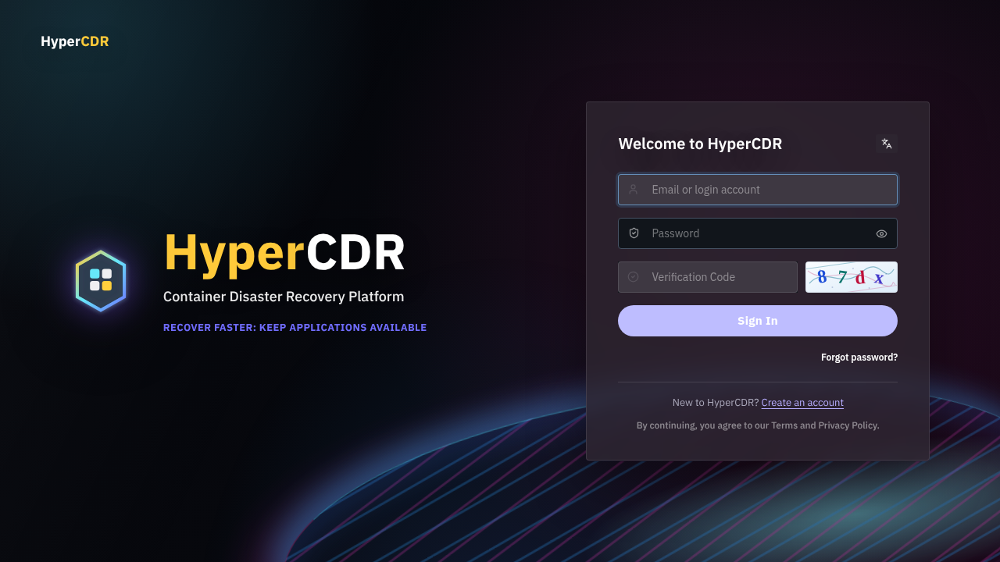

# HyperCDR 产品概览

## 1. 产品定位

HyperCDR 是面向 Kubernetes 工作负载的云原生容灾与恢复平台。平台由中控面、集群 Agent、对象存储和 Kubernetes 原生备份/恢复组件组成，用于将集群资源、应用配置和持久化数据纳入统一的保护、恢复验证和运维流程。

HyperCDR 的核心价值是把“保护、验证、恢复”组织成一条可追踪的 Kubernetes 应用容灾流程：管理员在中控平台登记集群和存储，选择需要保护的应用，按策略生成恢复点，再用 Drill 验证恢复结果，必要时执行 Restore。

HyperCDR 不是通用的虚拟机迁移产品。本文只介绍当前版本已提供的 Kubernetes 应用保护能力，不将 HyperBDR 的物理机、VMware 无代理、公有云专用接口或跨平台迁移能力作为 HyperCDR 功能承诺。

## 2. 适用场景

- Kubernetes 集群的应用级备份与恢复。
- 以对象存储作为备份介质的跨集群恢复。
- 通过 Drill 在隔离目标中验证恢复点可用性。
- 对恢复任务、同步任务和容灾任务进行统一进度、状态和日志审计。
- 需要多组织隔离、成员管理和平台级运维权限的私有化部署。

### 2.1 典型使用方式

| 使用目标 | 推荐做法 |
|---|---|
| 日常保护 | 为应用建立保护配置，按策略执行同步/备份并检查最新恢复点。 |
| 恢复可用性验证 | 在与生产隔离的目标 Namespace 执行 Drill，检查工作负载、PVC、Service 和业务数据。 |
| 生产恢复 | 评审恢复点、目标集群和资源映射后执行 Restore，并完成应用级验收。 |
| 多团队协作 | 使用组织、成员和角色权限隔离业务资源，按职责分配平台管理与容灾操作。 |

实际支持范围取决于 Kubernetes 发行版、Agent 版本、Velero/OADP 路径、CSI/存储驱动和对象存储兼容性；部署前应结合[适配范围](deployment/support-scope.zh.md)与现场验证确认。

## 3. 总体架构

从用户视角，平台包含三个协作部分：中控平台负责统一管理，集群 Agent 负责在目标集群执行任务，对象存储负责保存备份数据。用户不需要直接操作平台内部服务；只需确保这些部分之间的网络和权限满足安装及注册要求。

```text
浏览器 ── HTTPS 12443 ── Edge ── 活动前端/API（蓝或绿）
                                      │
                                      ├── PostgreSQL
                                      ├── 注册执行器 ── Kubernetes API
                                      └── WSS 出站连接 ── 集群 Agent

集群 Agent ── Kubernetes API/资源 ── Velero 或 OpenShift OADP ── 对象存储
```

### 3.1 中控平台

- React 前端提供登录、集群、存储、策略、容灾和任务页面。
- Go API 负责身份、组织隔离、资源管理、任务编排、Agent 通信和审计。
- PostgreSQL 持久化用户、组织、集群、策略、任务、恢复点和平台配置。
- HTTPS Edge 在宿主机 `12443` 终止 TLS，并将流量转发到当前蓝/绿前端和 API。
- 可选产品门户单独使用 `12445`，不属于中控登录页。

### 3.2 集群 Agent

Agent 主动通过出站 WSS 连接中控，周期性上报集群资源并接收任务。它不要求中控主动访问 Agent 入站端口；但 Agent 所在集群必须能访问中控 HTTPS/WSS 地址，并能访问所需镜像仓库和对象存储。

### 3.3 保护数据路径

保护、同步和恢复任务由平台下发给 Agent，再由 Agent 调用集群内的 Kubernetes、Velero 或 OADP 能力执行。对象存储保存备份数据，PostgreSQL 保存平台元数据和任务状态。平台数据库丢失不等同于对象存储备份丢失，但恢复完整平台必须同时保留数据库、平台密钥和必要配置。

## 4. 核心能力

### 4.1 集群接入

支持 Native Kubernetes、CCE 和 OpenShift 注册路径。平台可使用 **Install for me** 由注册执行器访问 kubeconfig 中的集群 API，也可使用 **Run command** 在具备集群网络和权限的主机执行生成命令。注册完成后，平台展示 Agent 在线状态、节点、Namespace 和资源清单。

### 4.2 存储与保护策略

管理员配置对象存储地址、Bucket、凭据及相关集群侧参数，再创建保护策略和保留规则。策略决定保护任务的调度与保留行为；配置保存成功不代表链路可用，必须用实际任务验证集群、Agent、组件和对象存储权限。

### 4.3 同步、恢复点与恢复

平台展示保护任务产生的恢复点，并跟踪同步、恢复和容灾任务状态。恢复前应核对目标集群、Namespace、资源映射和覆盖范围。任务详情中的阶段、进度、错误和详细日志用于判断实际执行结果，不能只看列表中的成功标签。

### 4.4 Drill 容灾演练

Drill 用于在隔离目标中验证恢复流程和恢复点可用性。演练应检查工作负载、PVC、服务和应用数据，而不仅是任务状态；演练目标、命名空间和资源映射必须与生产恢复计划隔离。

### 4.5 身份与组织隔离

社区版支持邮箱注册、Google 登录和组织邀请。每个账号属于一个组织，业务资源按组织隔离；平台管理员可以管理用户和组织，但不会因此获得跨组织的业务资源访问权。登录挑战支持图片验证码或 Cloudflare Turnstile，实际模式以安装目录 `.env` 为准。

### 4.6 升级与回滚

平台采用蓝绿方式运行 API 和前端。升级会启动候选颜色、执行健康检查、切换 Edge 流量并记录活动版本。回滚恢复应用流量和版本清单，但不会撤销已经执行的数据库迁移，也不代表集群 Agent 或集群组件已经升级。

## 5. 角色与权限

| 角色 | 主要职责 |
|---|---|
| 平台管理员 | 管理用户、组织、平台登录、邮件、平台升级等平台级配置；不能跨组织查看业务资源。 |
| 组织管理员 | 管理本组织资料、成员和邀请；使用本组织的集群、存储、策略和容灾资源。 |
| 普通成员 | 按授予权限使用本组织业务资源，不能管理平台或组织级设置。 |
| 集群 Agent | 代表已注册集群上报资源并执行平台下发任务，不是登录用户。 |

## 6. 产品边界

- HyperCDR 不自动安装 Docker；宿主机必须预先准备运行时。
- 平台不会自动替用户配置 DNS、外部反向代理、公开证书、对象存储或集群网络策略。
- 平台升级不等于所有集群 Agent 和组件升级完成，必须单独检查版本和任务结果。
- 自动生成的 TLS 证书用于启动 HTTPS，不等同于浏览器信任的公开证书。
- 不应将源码中存在的适配代码、构建资产或实验路径理解为所有发行版、驱动和拓扑均已认证。

## 7. 中控平台功能地图

当前社区版的中控按业务域提供 Dashboard、Clusters、Configuration、Disaster Recovery、Tasks 和 Settings 等入口。Dashboard 用于总览；Clusters 管理注册集群、Agent、清单、组件升级和日志；Configuration 管理 Storage、Policies 和 Tags；Disaster Recovery 管理保护配置、恢复点、Drill、Restore 和 Takeover；Tasks 展示任务状态、阶段、事件与详细日志；Settings 管理个人、组织、邮件、登录和平台升级。菜单会随版本和权限变化，页面不可见不代表绕过权限调用 API。

所有业务资源按组织（tenant）隔离。平台管理员可以管理用户和组织，但不能通过 URL、组织 ID 或请求头切换到其他组织的集群、存储、策略、应用、任务或恢复点。

## 8. 三类集群与执行组件

当前注册接口明确支持 `native-kubernetes`、`huaweicloud-cce` 和 `openshift` 三类集群。

### 8.1 Native Kubernetes

面向标准 Kubernetes API 的集群。Agent 读取清单、接收平台任务并调用 Velero 执行备份与恢复。注册可由中控注册执行器使用 kubeconfig 完成，也可在能访问集群的主机执行平台生成的命令。上传的 kubeconfig 必须内嵌凭据，最大 1 MiB，不能依赖外部 exec 插件或凭据文件。

### 8.2 Huawei Cloud CCE

CCE 使用独立的 kubeconfig 检查和注册会话。平台先建立临时上传会话并检查 context，再创建注册任务；会话绑定组织和上传者，平台重启后需重新上传并检查。CCE 仍通过 Agent、Kubernetes API、Velero 和对象存储执行保护，不等同于直接调用云厂商备份 API。

### 8.3 OpenShift

OpenShift 采用 OADP 兼容路径。保护和恢复受 OADP、项目权限、SecurityContextConstraints、CSI 快照和对象存储配置约束；当前向导对 OpenShift 默认资源范围有明确限制，不能按 Native Kubernetes 的全部资源选择能力理解。

三类集群共享中控任务模型，但注册检查、组件镜像、超时和后端适配不同。上线前应在目标发行版完成存储测试、同步和隔离恢复验证。

## 9. Agent、Velero/OADP 与数据路径

Agent 主动通过出站 WSS 连接中控，报告 Kubernetes 版本、节点、Namespace、资源和组件状态，并接收 inventory、storage-sync、backup、restore、drill、takeover、retention-cleanup、upgrade 和 unregister 等任务。中控不要求 Agent 提供入站端口，但集群必须能访问中控 HTTPS/WSS、镜像仓库和对象存储。

Agent 负责通信、编排和结果回报；Velero/OADP 负责 Kubernetes 资源和持久化数据；对象存储保存备份数据；PostgreSQL 保存平台元数据和任务状态。注销脚本不会删除应用 Namespace、Longhorn、外部对象存储或其他命名空间的 Velero 资源。

## 10. 备份、同步、恢复点与恢复

- **保护配置**：将源集群、应用/Namespace、策略和存储仓库组合为可执行关系。
- **同步/备份**：Agent 执行存储准备、备份或状态推进，平台接收事件并建立或更新恢复点。
- **恢复点**：由源集群、保护配置、备份任务和 Velero 备份名关联确定，可查看状态、保留信息和内容清单。
- **Restore**：向目标集群正式恢复资源和数据。
- **Drill**：向隔离目标验证恢复链路，不等同于生产接管。
- **Takeover**：按容灾切换流程执行接管，必须先通过校验和变更审批。

恢复点处于创建中、来源不匹配、保护配置已删除或仓库不可访问时，不应启动恢复。任务成功后仍需检查目标工作负载、PVC、Service、应用健康和数据；删除平台恢复点记录也不应被理解为立即擦除对象存储全部数据。

## 11. 配置边界与安全责任

用户、组织、策略、任务、恢复点等中控元数据保存在 PostgreSQL；秘密字段由 `HCDR_SECRET_KEY` 保护。完整平台备份必须同时保留数据库、秘密密钥、TLS 文件、`.env`、版本清单和对象存储访问配置。只备份数据库而丢失密钥，可能无法解密存储凭据；只保留对象存储而没有中控元数据，也不能恢复完整管理面。

登录挑战支持图片验证码和 Cloudflare Turnstile。图片验证码为四位数字/字母且字母不区分大小写；Turnstile 需要有效 key、浏览器访问 Cloudflare 控件和服务端出站校验。实际模式以安装目录 `.env` 为准。

## 12. 149 实机截图

登录入口已在 149 开发环境实际访问核验。登录后的业务截图需要有效账号和测试数据，因此不使用伪造的集群或任务页面。



