# HyperCDR 用户使用手册

本手册面向 HyperCDR 平台管理员、组织管理员和容灾运维人员，介绍从首次登录到应用保护、恢复验证和日常运维的标准操作流程。页面名称以当前社区版为准；不同版本可能增加字段或调整菜单位置。

## 目录

- [1. 产品使用流程](#1-产品使用流程)
- [2. 登录平台](#2-登录平台)
- [3. 组织、用户与权限](#3-组织用户与权限)
- [4. 注册集群](#4-注册集群)
- [5. 配置对象存储](#5-配置对象存储)
- [6. 创建保护策略](#6-创建保护策略)
- [7. 创建应用保护](#7-创建应用保护)
- [8. 执行同步与查看恢复点](#8-执行同步与查看恢复点)
- [9. 执行 Drill](#9-执行-drill)
- [10. 正式接管 Takeover 与恢复任务](#10-正式接管-takeover-与恢复任务)
- [11. 查看任务进度和详细日志](#11-查看任务进度和详细日志)
- [12. 组件升级和集群注销](#12-组件升级和集群注销)
- [13. 日常运维](#13-日常运维)
- [14. 常见问题](#14-常见问题)
- [15. 页面截图说明](#15-页面截图说明)
- [16. 发布版本说明](#16-发布版本说明)

## 1. 产品使用流程

推荐按以下顺序使用平台：

1. 完成平台安装并访问中控地址。
2. 登录后修改初始密码，确认组织和认证方式。
3. 注册源集群和目标集群，确认 Agent 在线。
4. 配置对象存储并测试连接。
5. 创建保护策略和应用保护配置。
6. 执行一次同步/备份，确认恢复点可用。
7. 在隔离环境执行 Drill，确认应用和数据。
8. 需要正式接管时，评审页面提供的 Takeover 操作及业务影响，再执行并验收；不要将任务类型 Restore 理解为独立创建入口。

> **重要提示**：列表中的“成功”只表示平台任务链路完成。生产验收还应检查 Pod、PVC、Service、应用健康状态和实际数据。

## 2. 登录平台

### 功能说明

HyperCDR 中控平台通过 HTTPS 提供登录和业务管理页面。登录挑战根据安装配置使用本地图片验证码或 Cloudflare Turnstile。

### 前置条件

- 已完成平台安装，拥有中控访问地址。
- 已获得有效账号；全新安装可使用安装说明中的初始管理员账号。
- 浏览器能够访问中控 HTTPS 地址；使用 Turnstile 时还需能访问 Cloudflare 校验服务。

### 操作步骤

1. 打开 `https://<中控地址>:12443`。
2. 输入账号和密码。
3. 输入图片验证码，或完成 Turnstile 挑战。
4. 点击 **Sign In**。
5. 首次进入后打开个人安全设置并修改初始密码。

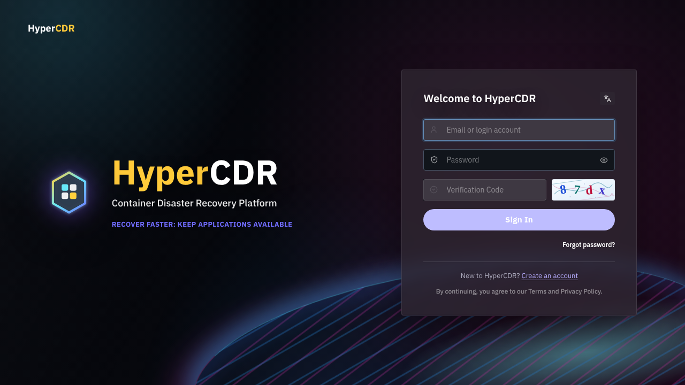

### 页面说明

| 页面元素 | 说明 |
| --- | --- |
| Email or login account | 登录账号或绑定邮箱 |
| Password | 当前密码；不要在截图或工单中暴露 |
| Verification Code | 图片验证码输入框，字母不区分大小写 |
| Create an account | 公开注册开启时显示；私有部署可能隐藏 |
| Forgot password | 已配置邮件服务时用于密码恢复 |

### 结果确认

登录成功后进入 Dashboard，并能看到当前账号所属组织和可用菜单。若没有业务菜单，先检查账号状态和组织归属，不要尝试通过修改 URL 绕过权限。

### 注意事项与常见问题

- 图片验证码为四位数字/字母；输入字母时不区分大小写。
- Turnstile 失败时检查站点配置、允许域名、浏览器出站网络和服务端 DNS/HTTPS。
- 证书为自签名证书时浏览器可能提示不受信任；生产环境应更换为受信任证书。

## 3. 组织、用户与权限

### 功能说明

组织用于隔离用户和容灾资源。一个账号属于一个组织，集群、存储、策略、应用、任务和恢复点只能在所属组织内使用。

### 前置条件

- 平台管理员可进入 **Users**、**Organizations**。
- 组织管理员可进入本组织的 **Organization**、**Members**。
- 需要邮件邀请时，平台已配置 **Email Service**。

### 操作步骤：邀请成员

1. 组织管理员进入 **Settings → Members**。Organization 和 Members 是不同入口，不是逐级展开的子菜单；平台管理员应先在组织管理中核对目标组织及其成员。
2. 点击邀请成员，填写邮箱和组织角色。
3. 发送邀请。
4. 等待成员完成邮件验证并首次登录。
5. 在成员列表确认状态为启用。

### 操作步骤：管理组织与用户

1. 平台管理员进入 **Settings → Organizations**，核对组织状态、成员及资源概况。创建组织后，还需要邀请首名组织管理员完成团队设置；不要把组织创建成功理解为已注册集群。
2. 组织管理员在 **Settings → Organization** 查看本组织资料，通过 **Edit organization** 修改名称和说明；普通成员以可见信息为准。
3. 平台管理员在 **Settings → Users** 查看账号、角色、绑定邮箱、状态和登录方式。内置管理员账号受到保护，自己的资料和邮箱在个人设置中管理。
4. 对页面允许编辑的成员，核对组织后修改角色或启用状态。保存可能撤销已有会话，操作前通知受影响用户。
5. 删除账号前确认责任已移交。删除会移除账号和登录身份，不能撤销，但不会连带删除组织业务资源。

如当前版本或权限未提供创建、邀请或编辑入口，不要通过修改 URL 或直接调用接口绕过限制。

### 页面说明

| 角色 | 可执行操作 |
| --- | --- |
| Platform administrator | 管理用户、组织、平台地址、邮件和平台升级；不自动获得其他组织业务资源 |
| Organization administrator | 管理本组织资料、成员和邀请，使用本组织业务资源 |
| Member | 按权限使用本组织业务资源 |

| 成员与邀请信息 | 说明 |
| --- | --- |
| Organization | 账号所属组织，邀请时必须核对；不是登录后任意切换的工作空间 |
| Email | 邀请接收地址，需实际收到邮件并完成验证 |
| Organization role | 组织管理员或成员，不等同于平台管理员 |
| Status | 账号启用状态或邀请处理状态，注意区分两类记录 |
| Expires | 邀请到期时间，按用户选择的时区显示 |
| Bound email | 已绑定邮箱，不能在平台用户编辑窗口任意改写 |

### 结果确认

成员能登录并仅看到所属组织资源。禁用或删除账号会撤销其会话，但不会删除该组织的集群、存储、策略或备份数据。

### 注意事项与常见问题

- 每个组织应至少保留一名有效组织管理员。
- 不能通过请求头、URL 或组织 ID 切换业务组织。
- 删除账号前先移交任务和资源管理责任。
- 邀请邮件发送成功不代表账号已建立；用户完成验证后再确认成员记录。邀请过期或被撤销时应重新按授权流程处理。

## 4. 注册集群

### 功能说明

集群注册把 Kubernetes 集群接入中控，使 Agent 能主动上报资源并接收备份、恢复和演练任务。当前支持 Native Kubernetes、Huawei Cloud CCE 和 OpenShift。

### 前置条件

- 集群 API 可访问，准备好内嵌凭据的 kubeconfig。
- kubeconfig 不依赖外部 exec 插件或本机凭据文件，大小不超过 1 MiB。
- 集群能访问中控 HTTPS/WSS、所需镜像仓库和对象存储。
- 已确定集群类型和 Agent/Velero 或 OADP 版本。

### 操作步骤

1. 进入 **Configuration → Clusters**，点击 **Register Cluster**。
2. 选择集群类型：`Native Kubernetes`、`Huawei Cloud CCE` 或 `OpenShift`。
3. 选择 **Install for me** 或 **Run command**。
4. 使用 **Install for me** 时上传 kubeconfig，选择正确 context，执行集群检查；检查结果返回后核对集群与节点信息，选择用于安装的 StorageClass，再提交 **Register cluster**。
5. 使用 **Run command** 时复制一次性命令，在能够访问集群的跳板机执行。
6. 返回 **Clusters**，等待 Agent 建立出站连接。
7. 检查集群卡片的节点、Namespace 和组件状态，需要时刷新资源信息。不要把注册任务创建成功当作 Agent 已就绪。

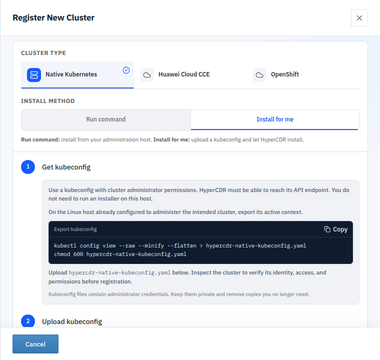

上图为 Native Kubernetes 的 **Install for me** 页面，尚未上传文件或创建安装任务。可在已经配置集群管理权限的主机上先确认当前 context，再按页面指引导出内嵌凭据的配置：

```bash
kubectl config current-context
kubectl config view --raw --minify --flatten > hypercdr-native-kubeconfig.yaml
chmod 600 hypercdr-native-kubeconfig.yaml
```

`--minify` 只导出当前 context 的相关配置，因此必须先确认当前连接的是目标集群。`--raw` 输出包含真实凭据，不要将命令结果打印到公开终端记录或粘贴到文档；导出文件按凭据管理要求保存，使用完后处理不再需要的副本。CCE 与 OpenShift 请按各自向导提供的获取说明准备文件。

### 页面说明

| 项目 | 说明 |
| --- | --- |
| Cluster type | 决定注册检查、组件和后端路径 |
| Install for me | 由中控注册执行器访问集群并安装 |
| Run command | 由用户在可访问集群的主机执行生成命令 |
| Agent status | 显示 online/offline 和最近心跳 |
| Inventory | 节点、Namespace、资源和存储类清单 |
| kubeconfig / Context | 上传的集群访问配置与实际操作上下文，文件含多个 context 时尤其需要核对 |
| 集群检查结果 | 核对集群名称、Kubernetes 版本、节点数、存储类和未通过检查项 |
| StorageClass | 供注册安装使用的目标存储类；默认项不代表一定符合现场容量和驱动要求 |
| Registration in progress | 正在执行预检查、组件安装或就绪验证，不应重复提交注册 |

### 三类集群差异

下图为 149 实机注册向导中的集群类型选择区域。默认选中 Native Kubernetes；请选择实际发行版，不要仅按集群名称判断类型。


- **Native Kubernetes**：通过 Kubernetes API 和 Velero 执行标准集群保护与恢复。
- **Huawei Cloud CCE**：通过 CCE kubeconfig 检查会话注册；仍由 Agent 和 Velero 执行任务。
- **OpenShift**：使用 OADP 路径，受项目权限、SCC、CSI 和 OADP 配置约束，部分资源范围以页面提示为准。

### 结果确认

集群详情应显示 Kubernetes 版本、节点和 Namespace，Agent 状态为 online，并能刷新 inventory。集群记录存在但 Agent offline 不代表安装成功。

### 注意事项与常见问题

- 不要把注册命令、Token 或 kubeconfig 粘贴到公开工单。
- Agent 采用出站 WSS，中控不需要访问 Agent 入站端口。
- 注册执行器卡住时检查 kubeconfig context、RBAC、网络和执行器日志。
- 临时上传会话失效、取消或平台重启后，按提示重新上传和检查，不要复用已经失效的检查结果。

## 5. 配置对象存储

### 功能说明

对象存储用于保存备份数据和恢复所需对象。中控保存仓库配置，实际保护和恢复还需要 Agent 所在集群能够访问该仓库。

### 前置条件

- 已注册并在线的集群。
- 已准备 endpoint、Bucket、区域、访问密钥和秘密密钥。
- 中控和集群网络均能解析并访问 endpoint。

### 操作步骤

1. 进入 **Configuration → Storage**。
2. 点击新建，填写仓库名称和存储类型。
3. 填写 Endpoint、Bucket 和区域，按存储服务要求选择 SSL/TLS 和 URL Style。
4. 填写访问密钥和秘密密钥。
5. 填写完成后执行 **Test Connection**，检查结果，再点击 **Save Storage**。不要将保存配置成功视为集群侧备份链路已验证。
6. 在需要使用的保护配置中选择该仓库。

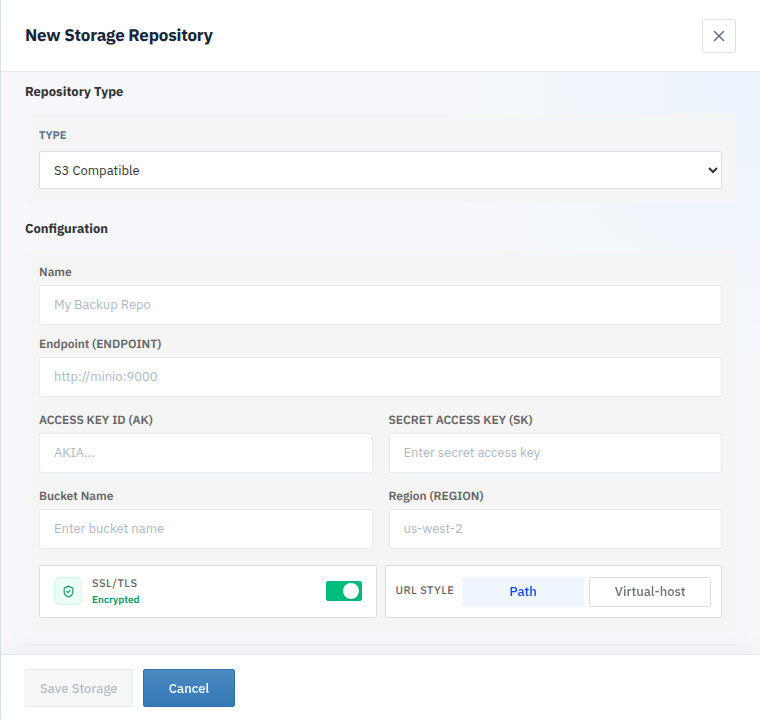

上图为未填写凭据的新建窗口。不同存储类型显示的配置项不同；以下以 S3 Compatible 为例。

### 字段说明

| 字段 | 说明 |
| --- | --- |
| Name | 中控内显示的仓库名称 |
| Type | 当前发布包支持的对象存储类型 |
| Endpoint | 对象存储服务地址，含 TLS/路径形式要求 |
| Bucket | 存放备份数据的 Bucket |
| Region | 后端要求时填写的区域 |
| SSL/TLS | 是否使用加密连接；应与 Endpoint 协议和服务端证书配置一致 |
| URL Style | Path 将 Bucket 放在请求路径中，Virtual-host 将 Bucket 放在主机名中；按存储服务要求选择 |
| Access/Secret key | 具备读写和列举权限的凭据 |

### 结果确认

连接测试成功，且从集群侧执行保护任务时没有 endpoint、Bucket 或权限错误。保存表单成功不能代替连接测试。

### 注意事项与常见问题

- 多个源集群应使用明确前缀，避免数据混淆。
- 更换正在使用的仓库使用 **Reconfigure DR Storage**，不要直接改数据库。
- 截图、日志和工单中不得出现秘密密钥。

## 6. 创建保护策略

### 功能说明

策略定义备份频率和保留规则，可供多个保护配置引用。

### 前置条件

- 已有可用集群和对象存储。
- 已明确应用恢复目标、备份频率和保留要求。

### 操作步骤

1. 进入 **Configuration → Policies**。
2. 点击新建策略。
3. 设置名称、调度/频率、保留数量或保留期限。
4. 保存并确认策略状态可用。
5. 在应用保护配置中引用策略。

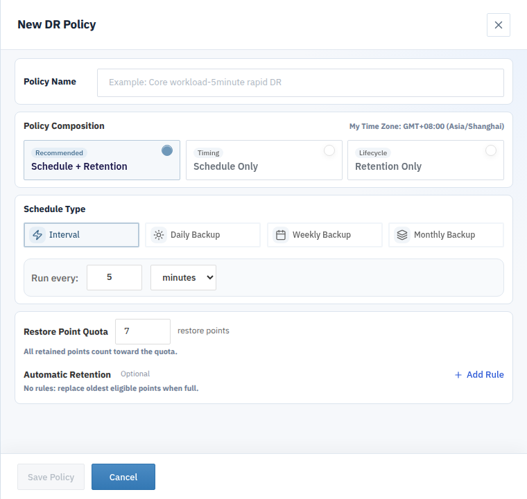

### 字段与页面说明

| 字段 | 说明 |
| --- | --- |
| Policy Name | 用于识别和选择策略，建议包含业务等级、频率或保留要求 |
| Schedule + Retention | 同时配置定时执行和恢复点保留，页面推荐组合 |
| Schedule Only | 仅定义执行计划；不要据此推断已设置保留规则 |
| Retention Only | 仅定义恢复点生命周期；不会因此自动产生定时备份 |
| Interval | 按分钟或小时设置执行间隔 |
| Daily / Weekly / Monthly Backup | 按日、周或月设置执行计划；保存前核对页面显示的用户时区 |
| Restore Point Quota | 保留恢复点数量配额；页面说明所有保留点均计入配额 |
| Automatic Retention / Add Rule | 添加可选自动保留规则；未设置规则时，配额满后替换符合条件的最旧恢复点 |

截图中的 5 分钟和 7 个恢复点是新建表单的当前显示值，并非所有业务的推荐配置。应按数据变化量、对象存储容量和恢复目标确定参数。

### 结果确认

策略出现在可选择列表中，且保护配置引用的是预期策略。修改策略前检查其引用的应用范围。

### 注意事项

策略是可复用规则，保护配置才是规则与具体应用、集群和存储的绑定。策略存在不等于已经创建恢复点。

## 7. 创建应用保护

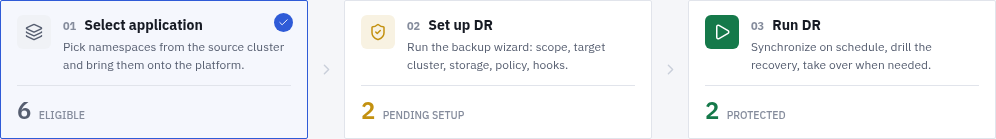

页面将操作分为 **Select application → Set up DR → Run DR** 三个阶段。第一阶段选择源集群中的 Namespace；第二阶段完成保护范围、目标集群、存储、策略和 Hooks 设置；第三阶段查看已保护应用并开展同步和恢复验证。阶段中的数量是当前集群的实际统计，不是任务进度。

### 功能说明

应用保护配置选择需要保护的 Namespace/工作负载、源集群、目标集群、存储和策略。

### 前置条件

- 源集群 Agent online。
- 对象存储测试成功。
- 已创建策略，并准备好目标集群或隔离目标。

### 操作步骤

1. 进入 **DR → Application DR**，选择源集群。
2. 在 **Select application** 中核对需要保护的业务 Namespace，选择后按页面提示进入下一阶段。
3. 在 **Set up DR** 中完成保护向导：先检查资源范围及排除项，再选择默认目标集群。
4. 选择存储方式、仓库和策略。Local CSI Snapshot 与 Remote Repository 的依赖不同，不要认为本地快照天然具备跨集群、跨存储恢复能力。
5. 业务需要备份前后处理时配置 Hooks；不需要则保持未配置，不为完成向导而添加空脚本。
6. 在 **Configuration Review** 核对 Scope、Target、Storage、Policy 和 Hooks，确认后提交。
7. 返回 **Run DR** 检查配置状态。恢复时的目标 Namespace、存储类和镜像映射在恢复向导中另行核对，不应当成保护向导已经执行过的恢复操作。

### 字段与页面说明

| 配置项 | 含义和核对要点 |
| --- | --- |
| Scope | 需要保护的资源范围；排除规则可能使部分资源不进入备份 |
| Default target | 默认恢复目标集群，不代表提交保护后立即在目标端创建业务资源 |
| Remote Repository | 使用对象存储仓库，核对仓库及集群访问条件 |
| Local CSI Snapshot | 依赖本地 CSI 快照能力，应核对驱动和恢复边界 |
| Policy | 可复用调度和保留配置；手动触发策略不产生定时执行计划 |
| Pre-backup Hook | 备份前执行，可用于应用静默、刷新或检查；需自行验证脚本正确性 |
| Post-backup Hook | 备份后处理，可用于恢复应用状态、清理或通知 |
| Entry script / Dependencies | Hook 入口与依赖文件；核对入口选择和依赖完整性 |
| Configuration Review | 提交前汇总页面，不等于第一次备份已完成 |

### 结果确认

应用页面显示保护配置已激活，源集群、策略和存储引用正确。首次同步完成后才会出现可用恢复点。

### 注意事项

不要把平台组件、无关 Namespace 或凭据误加入应用范围。应用标签只用于分类，不会改变保护范围。

Hook 脚本可能影响应用状态，只使用经过业务负责人审阅和验证的脚本。未配置 Hooks 不代表备份自动具备数据库应用一致性；应根据业务写入和恢复要求制定一致性方案。

## 8. 执行同步与查看恢复点

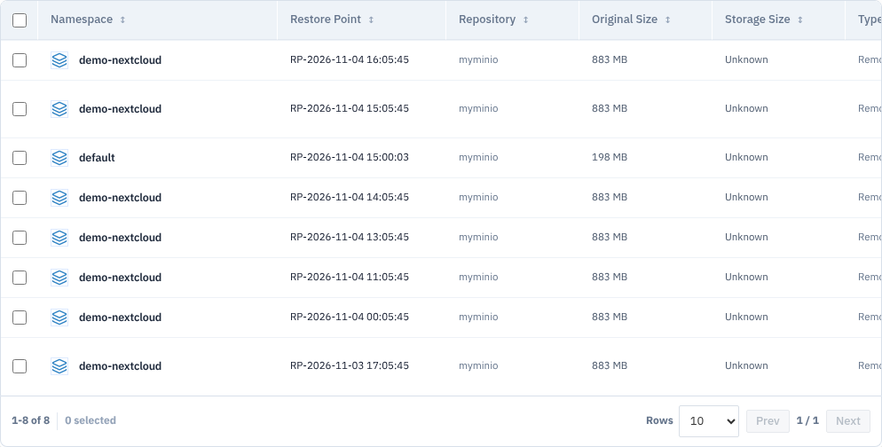

### 恢复点页面说明

| 列 | 使用说明 |
| --- | --- |
| Namespace | 恢复点所属应用命名空间，恢复前须与保护对象核对 |
| Restore Point | 恢复点显示名称，时间按用户选择的时区展示 |
| Repository | 备份所在的存储仓库，恢复时仍需保持可访问 |
| Original Size | 页面已获取的原始数据大小，不应直接当作对象存储实际占用 |
| Storage Size | 存储增量等信息不可获取时显示 Unknown；Unknown 不等于零，也不能单凭该值判断备份失败 |
| Recovery Task | 关联恢复任务及其状态；没有恢复任务不等于恢复点不可用 |

截图为列表局部，右侧未显示的列可通过表格横向滚动查看。选择恢复点前先核对源集群、Namespace、时间与仓库，不要只依靠最近一条记录判断可恢复性。

### 功能说明

同步/备份任务把应用资源和数据写入对象存储，并由平台建立恢复点。

### 前置条件

- 保护配置已激活。
- Agent、存储和 Velero/OADP 正常。
- 没有同一保护配置的冲突运行任务。

### 操作步骤

1. 进入 **DR → Application DR → Run DR**，选择需要同步的应用，点击 **Start Sync**。
2. 确认源集群、应用范围、仓库和策略。
3. 提交任务。
4. 进入 **Backup & Recovery Tasks** 查看进度。
5. 任务完成后进入 **Restore Points** 打开恢复点详情。

### 结果确认

恢复点状态为可用，源集群和应用范围正确，内容清单包含预期资源，且详细日志没有隐藏的资源级失败。

### 注意事项

不要只依据列表状态；恢复点创建中、来源不匹配或仓库不可访问时不要执行恢复。

## 9. 执行 Drill

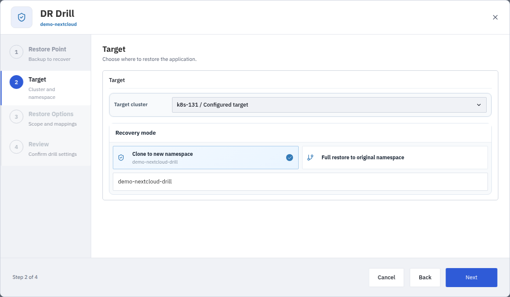

### 字段与页面说明

向导按 **Restore Point → Target → Restore Options → Review** 四步组织操作。Restore Point 页面应确认状态为 Available，并核对源集群、Namespace 和备份时间；Target 页面选择目标集群及恢复模式。

| 选项 | 说明与风险 |
| --- | --- |
| Target cluster | 实际执行恢复的目标集群；不能只检查源集群在线状态 |
| Clone to new namespace | 恢复到新 Namespace；隔离演练优先采用此方式，并核对命名空间未被生产使用 |
| Full restore to original namespace | 恢复到目标集群的原同名 Namespace；可能与现有资源冲突，不应当作隔离演练默认选择 |
| Target namespace | 克隆模式下的目标命名空间；示例中的 `demo-nextcloud-drill` 只是当前表单值 |
| Restore Options | 核对恢复范围和映射后再进入 Review；进入向导和点击 Next 不代表已经提交任务 |

> **注意**：Drill 的名称本身不保证目标隔离。提交前必须核对恢复模式、目标集群和 Namespace，避免影响已有工作负载。

### 功能说明

Drill 用于验证恢复点能否恢复为可运行的应用。只有正确选择隔离目标并控制网络访问，才能降低对生产应用的影响；选择原同名 Namespace 或与生产共享外部服务时仍有业务风险。

### 前置条件

- 已有可用恢复点。
- 准备隔离目标集群和 Namespace。
- 规划资源名称、网络、Service、Ingress 和 PVC 冲突处理。

### 操作步骤

1. 在 **Restore Points** 选择恢复点。
2. 点击 **Drill**。
3. 选择目标集群和隔离 Namespace，配置资源映射。
4. 提交 Drill 任务。
5. 在任务详情查看资源恢复、工作负载就绪检查和最终结果；仅当页面实际出现清理阶段时，再检查清理结果。
6. 到目标集群检查工作负载、PVC、Service 和应用数据。
7. 验证结束后按演练清理计划处理演练资源。先确认清理对象属于本次演练，不要删除生产 Namespace 或共享存储；不要将任务完成理解为演练资源已自动删除。

### 结果确认

目标工作负载就绪，应用健康检查和实际数据验证通过，任务详细日志没有资源级失败。Drill 成功不等同于生产 Restore 已获批准。

### 注意事项与常见问题

- 演练前限制目标应用的出站网络，防止恢复后的定时任务、邮件、支付或外部写入访问生产服务。
- 目标应用未就绪时，结合任务事件检查 Pod、PVC 和依赖服务；资源已创建不等于业务已恢复。
- 演练结束后记录所用恢复点、目标、验证结果和遗留资源，供后续接管评审使用。

## 10. 正式接管 Takeover 与恢复任务

### 功能说明

Restore 表示将备份资源和数据恢复到目标集群的任务能力。当前已核验的恢复点列表和应用恢复点操作菜单提供 **Drill**、**Takeover**，未提供独立的 **Restore** 按钮。任务列表能够展示 Restore 类型记录，不代表页面存在同名创建入口。请勿把 Drill、Takeover 与 Restore 当作可以互换的操作。

Takeover 用于按选定恢复点和配置在目标端恢复应用，属于正式容灾操作。恢复完成后仍需按业务方案处理访问入口和业务验收；不能仅凭操作名称假定 DNS、外部负载均衡或所有第三方依赖已自动切换。

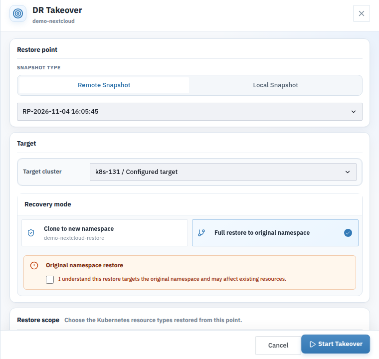

图为未提交的配置窗口局部。当前选中的是 **Full restore to original namespace**，风险确认框尚未勾选；此状态不代表已经执行接管，也不是推荐配置。

### 前置条件

- 已通过 Drill 或完成恢复点评审。
- 已完成变更审批和回退方案。
- 目标容量、权限、PVC/CSI、网络和资源映射已确认。
- 已安排源端与目标端的业务写入控制，防止两端同时对共享外部服务写入。
- 已明确入口切换、外部依赖检查、验收责任人和失败后的处置方案。

### 操作步骤

1. 进入 **DR → Restore Points**，核对当前源集群、Namespace 和恢复点时间，选择需要接管的恢复点。
2. 点击 **Takeover**，打开 **DR Takeover**。再次核对恢复点，避免误用其他应用或时间点。
3. 在 **Target cluster** 中选择目标集群。不可用或类型不兼容的选项不能作为有效目标。
4. 选择恢复模式：克隆到新 Namespace，或恢复到目标端原同名 Namespace。选择原命名空间时，先评估现有资源影响，再确认风险提示。
5. 在 **Restore scope** 核对默认或自定义资源范围。默认范围包含 Namespace 级资源，不包含集群级资源；不要将其理解为整个集群恢复。
6. 如环境不同，展开 **Advanced options**，检查 StorageClass、业务镜像和 Service NodePort 映射，以及工作负载就绪和应用验证选项。
7. 对照已批准的接管方案复核目标、范围和数据时间点，确认后点击 **Start Takeover**。尚未批准时使用 **Cancel** 或关闭窗口，不提交任务。
8. 在 **DR → Backup & Recovery Tasks** 查看接管任务，并在应用的 **Recovery Status** 中检查恢复阶段和最终结果。不要将成功的 Drill 记录当作接管记录。
9. 检查目标工作负载、PVC、Service 和业务数据，按业务方案完成访问入口切换与应用验收。

### 页面说明

| 名称 | 含义 |
| --- | --- |
| Restore 任务类型 | 恢复任务记录分类，不能据此推断有独立创建按钮 |
| Drill | 验证恢复点和应用恢复过程；应选择隔离目标 |
| Takeover | 页面提供的接管入口，属于独立业务操作，执行前必须核对影响和审批 |
| Snapshot type | 按页面提供的 Remote Snapshot 或 Local Snapshot 选择来源；显示某个类型不代表该应用一定有对应可用恢复点 |
| Clone to new namespace | 将资源恢复到新命名空间；仍须检查外部依赖和网络隔离 |
| Full restore to original namespace | 目标端原同名命名空间恢复，可能影响已有资源，需明确风险确认 |
| StorageClass 映射 | 将备份中的存储类映射到目标可用存储类；名称相同不证明底层能力相同 |
| 业务镜像映射 | 为源镜像指定目标镜像；留空保留备份中的值，目标集群仍须能够拉取镜像 |
| Wait for workloads and pods to become ready | 等待工作负载和 Pod 就绪，不等同于业务数据已通过人工验收 |
| Run application validation | 按已配置的验证能力进行应用检查，不能替代业务验收计划 |

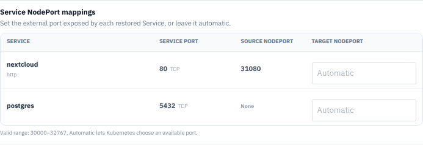

NodePort 映射按 Service 和服务端口配置。页面显示的有效范围为 `30000–32767`，留空 Automatic 由 Kubernetes 选择可用端口。修改后还应检查防火墙、负载均衡和访问地址；不要照抄截图中的 `31080`，也不要假定自动分配仍与源端端口一致。

请使用页面实际提供的 Drill 或 Takeover 入口。不要寻找或假定存在独立 Restore 创建按钮。

### 结果确认

任务完成且目标资源、PVC、Service、应用健康检查和数据均符合预期。记录恢复点、目标版本、开始/结束时间和遗留告警。

### 注意事项

- 不要重复点击创建相同恢复任务。发现目标冲突、权限错误或数据异常时，先停止后续变更并保留现场。
- 恢复失败不表示目标端没有创建任何资源；重试前先核对已恢复内容，不要直接清空原业务命名空间。
- 平台任务成功后，访问入口、外部依赖和业务数据仍需验收。完成流量切换前，不应只依据百分比宣布业务恢复。

## 11. 查看任务进度和详细日志

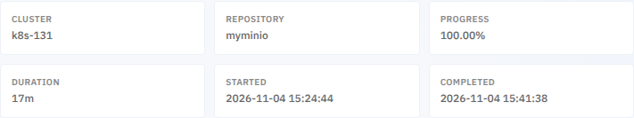

进度截图来自一个已经完成的任务，不能作为实时运行中的进度示例。Cluster 是实际任务执行集群，可能与页面当前选中的源集群不同；Started 和 Completed 按用户选择的时区展示。记录问题时同时保留任务 ID、类型和时间，避免把不同任务的进度或错误拼接在一起。

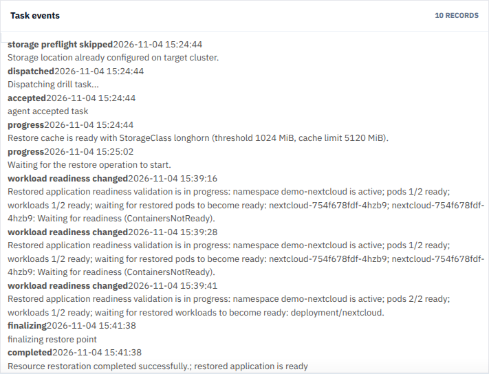

上图来自既有 Drill 任务，而非本次为截图重新执行。事件记录展示存储预检查、下发、Agent 接受、恢复等待、工作负载就绪检查和完成过程。`accepted` 只表示 Agent 已接受任务，不能作为恢复成功依据；`workload readiness changed` 表示应用就绪检查发生变化，应结合其中 Pod 和工作负载数量判断等待原因。

截图中的 `completed` 明确报告资源恢复完成且应用就绪。它是该任务的实际结果，不表示其他恢复点或其他目标集群已通过验证；业务数据仍需应用负责人验收。

### 功能说明

任务页面用于查看同步、备份、恢复、Drill、Takeover、清理和组件升级的执行状态。

### 前置条件

- 已登录具有相应组织资源访问权限的账号。
- 已有目标任务，并知道所属源集群或应用 Namespace。
- 当前选择的时间范围覆盖任务发生时间；默认近期视图可能不显示较早任务。

### 操作步骤

1. 进入 **Backup & Recovery Tasks**。
2. 按类型、状态、集群或时间筛选任务。
3. 打开任务详情，查看任务类型、执行集群、百分比、耗时、开始和完成时间；需要阶段细节时打开应用同步或恢复状态详情。
4. 展开事件和详细日志。
5. 记录任务 ID、首个失败阶段和关联错误。
6. 如需重试或取消，先确认当前任务和页面实际提供相应操作。不要假定所有任务都有 **Retry** 或 **Cancel**；存储配置失败的专用详情可按页面提示使用 **Retry DR configuration**。

### 应用状态详情与任务事件的区别

**DR → Application DR** 中的执行状态可打开相应详情。同步任务使用 **Sync Details**，恢复类任务使用 **Recovery Details**，存储准备任务使用 **DR Configuration Details**。这些详情包含执行阶段时间线、失败或告警说明和最终结果；正在执行但进度不新鲜时，应先检查页面提示，不要把暂时没有新事件判断为必然卡死。

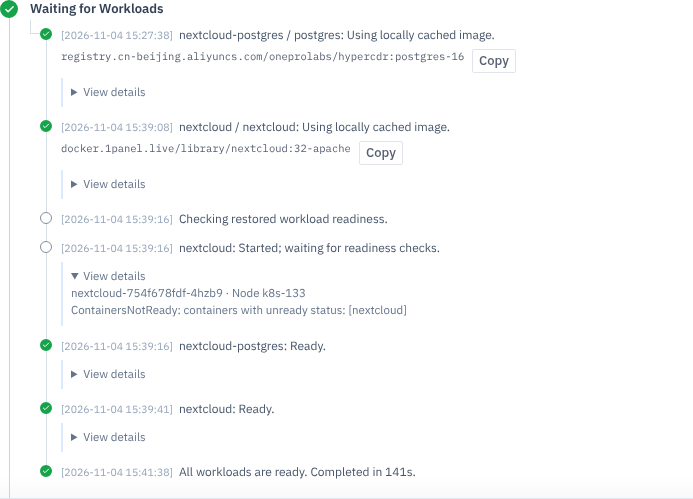

上图是一次已完成 Drill 的 **Waiting for Workloads** 阶段。应用曾出现 `ContainersNotReady`，随后变为 Ready，最终全部工作负载就绪。这说明历史等待事件不会因为任务成功而消失，判断当前结果时应结合后续事件和最终结果，不能仅凭一条旧的等待消息认定任务失败。

**查看恢复执行详情**：

1. 进入 **DR → Application DR → Run DR**，确认源集群和应用。
2. 点击该应用的 **Recovery Status** 状态内容，打开 **Recovery Details**。
3. 按阶段检查准备恢复、Kubernetes 资源恢复、持久化数据恢复、工作负载就绪、应用验证和任务收尾。实际阶段以任务类型和页面展示为准。
4. 在工作负载事件中展开 **View details**，查看关联 Pod、节点和等待原因。示例中的 `ContainersNotReady` 表示容器尚未通过就绪检查，并不表示备份数据一定损坏。
5. 检查底部 **Final result**，再到目标应用进行业务验收。

**查看同步执行详情**：在同一应用行点击 **Sync Status** 状态内容，打开 **Sync Details**，结合阶段、事件、最新恢复点和下一次调度时间判断保护是否正常。没有恢复任务的应用会显示 **No recovery task**；这不等于没有备份，也不代表已完成恢复验证。

**Backup & Recovery Tasks → Task Details** 展示任务摘要和 **Task events**。本节的事件截图仅表示事件记录，并不是完整的 Velero、Pod 或组件原始日志。需要资源级排障时，应继续检查关联组件日志；不要把 **Technical payload** 技术数据直接作为普通用户的操作步骤，也不要未经脱敏公开其中内容。

### 重点字段

| 信息 | 用途 |
| --- | --- |
| Task type | 区分 backup、restore、drill、upgrade 等 |
| Stage/Progress | 定位卡住的执行阶段 |
| Events | 查看平台、Agent、Kubernetes 和后端事件 |
| 关联组件日志 | 在平台事件不足以定位问题时，由集群运维人员检查；任务事件并不等于完整组件日志 |
| Source/Target | 核对源集群、目标集群和 Namespace |

### 结果确认

以阶段、事件、资源级结果和目标实际状态共同判断任务结果；不要只看列表中的成功或失败标签。

### 注意事项与常见问题

- 时间范围内无任务时，先核对集群、Namespace、筛选条件和时间范围，不要重复提交业务任务来刷新列表。
- 列表成功不代表业务数据验证完成；任务失败也不表示目标没有创建任何资源。
- 详情加载失败时关闭后重新打开，保留任务 ID；不要把空白详情理解为没有日志或任务成功。

## 12. 组件升级和集群注销

### 12.1 组件升级

#### 功能说明

升级已注册集群的通信 Agent 或备份组件。中控平台升级与集群组件升级是独立操作；更新中控后，应逐集群检查是否存在可用更新，不要默认全部 Agent 已同步升级。


图中的 **Up to date** 表示当前页面未提供该组件的新版本；**Ready** 与 **Last Seen** 用于检查连接状态。示例版本不代表所有部署应固定使用该版本。

#### 前置条件

- 已确认目标集群和维护窗口，保留当前版本和回退方案。
- 集群在线，能够拉取目标镜像，节点有足够资源完成滚动更新。
- 没有正在运行的备份、Drill、恢复、清理或其他升级任务。

#### 操作步骤

1. 进入 **Configuration → Clusters**，找到目标集群。
2. 在相应组件的 **Update** 入口检查更新。通信组件打开 **Upgrade Agent**；Velero 组件打开 **Upgrade Velero**。没有更新入口时不要将其他组件的升级当作替代。
3. 核对当前版本、目标版本和镜像标识；Velero 升级还应核对服务端与 Node Agent 范围。
4. 确认维护条件后提交。只打开升级窗口不会创建升级任务；不准备执行时选择取消。
5. 在集群任务记录中跟踪升级，等待通信恢复和组件就绪。

#### 字段与页面说明

| 信息 | 说明 |
| --- | --- |
| Current Version / Current | 当前组件版本；Unknown 表示未获得版本信息，不代表需要强制升级 |
| Target Version / Target | 本次目标版本，提交前核对与平台发行版的兼容性 |
| 镜像摘要 | 辅助确认实际镜像身份，不应仅凭相同标签判断内容相同 |
| Upgrade Scope | Velero 升级窗口中的 Server Deployment 和 Node Agent DaemonSet 范围 |
| Node Agent ready | 已就绪节点代理与期望数量；升级后应检查是否达到期望值 |

#### 结果确认

升级任务成功，组件报告目标版本，Agent 恢复在线，备份组件与 Node Agent 就绪。维护窗口内再按批准的验证计划检查保护和恢复功能，不要只以任务创建成功作为升级验收。

#### 注意事项与常见问题

- Agent 滚动更新期间可能短暂离线；若持续离线，应检查 Pod、镜像拉取和出站连接，不要反复提交升级。
- OpenShift 的组件路径与 Native Kubernetes 不同，应以实际页面提供的组件能力和适配范围为准。
- 平台回滚不会自动回滚集群组件。

### 12.2 集群注销

#### 功能说明

解除平台对集群的管理，并清理受管 HyperCDR 和 Velero 资源。正常注销与强制移除不同：强制移除不能证明集群端组件和备份数据已清理。

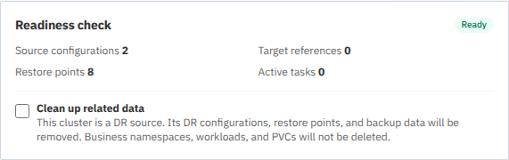

图中即使显示 **Ready**，仍有源保护配置和恢复点，且数据清理选项尚未勾选。Ready 不能代替数据删除授权；操作人仍须逐项核对影响。

#### 前置条件

- 已确认不再使用该集群承担当前保护或恢复任务，并取得数据清理授权。
- 正常注销要求 Agent 在线，没有冲突的运行任务。
- 已审阅该集群作为源端和目标端的保护关系、恢复点及备份保留要求。

#### 操作步骤

1. 在 **Configuration → Clusters** 找到集群，打开操作菜单中的 **Unregister Cluster**。
2. 核对 **Selected Cluster**，等待 **Readiness check** 完成。
3. 阅读阻塞原因，检查源保护配置、目标引用、恢复点及活动任务数量；不要绕过未完成任务。
4. 如页面要求 **Clean up related data**，先阅读下表的数据影响。只有获得清理授权后才能选择，不要为了让按钮可用而直接勾选。
5. 确认正常注销条件满足后点击 **Confirm Unregister**，到 **Recent Tasks** 跟踪结果。
6. 仅当 Agent 或集群永久不可用、正常注销无法完成时，才评审 **Force remove**。按页面要求输入 `Yes` 后操作，并另行安排残留资源清理。

#### 字段与页面说明

| 字段或选项 | 含义与影响 |
| --- | --- |
| Source configurations | 该集群作为保护源的配置数量 |
| Target references | 其他保护配置引用该集群作为目标的数量 |
| Restore points / Active tasks | 关联恢复点与活动任务数量；用于评估清理风险和阻塞条件 |
| Clean up related data：源集群 | 清理源保护配置、恢复点和备份数据，可能失去恢复能力 |
| Clean up related data：目标集群 | 保留其他源端的保护配置和备份数据，仅清除其默认目标引用 |
| Historical storage data detected | 检测到历史存储使用情况，正常注销会检查并清理该集群存储前缀 |
| Force remove | 用于永久不可用场景，不等同于成功执行正常集群端清理 |

#### 结果确认

正常注销任务成功，平台不再将该集群作为可用受管集群，相关保护引用按已确认选项处理。集群运维人员应确认受管组件清理结果及业务应用保留情况；强制移除后需单独登记和处理残留。

#### 注意事项与常见问题

- 注销不删除业务 Namespace、工作负载和 PVC，但选择关联数据清理可能删除备份数据；两者不可混为一谈。
- 不会因为注销而删除整个外部对象存储服务，但不能据此认为其中的备份前缀一定保留。
- 注销失败时保留任务 ID 和第一个错误，先修复权限、Agent 或存储问题，再重试正常注销。

## 13. 日常运维

### 13.1 日常巡检

#### 功能说明

巡检用于及时发现保护中断、恢复点过旧、组件离线和历史失败，避免只在故障时才发现没有可用恢复点。

#### 前置条件

已确定业务保护目标、恢复点时间要求、巡检频率和问题负责人；账号具有相应组织的资源访问权限。

#### 操作步骤

1. 在 Dashboard 检查保护活动和告警，再进入 **Configuration → Clusters** 检查 Agent 在线、组件状态和最后上报时间。
2. 检查对象存储连通性、容量和凭据有效期。不要只检查中控到存储的网络，备份与恢复组件也必须能访问仓库。
3. 在 **DR → Application DR → Run DR** 检查保护配置、同步状态与下一次调度；在恢复点列表核对最新可用恢复点时间。
4. 查看失败和长时间未更新的任务，记录任务 ID、时间、集群和第一个错误事件，按第 11 节进一步定位。
5. 按批准计划定期执行隔离 Drill，记录应用、数据和访问检查结果；验证后处理演练遗留资源。
6. 平台维护前备份数据库、`.env`、秘密密钥、TLS 和版本清单，并验证备份的可用性。

#### 页面与记录说明

| 检查项 | 应记录的内容 |
| --- | --- |
| 集群与组件 | 在线状态、最后上报时间、组件版本及异常 |
| 应用保护 | 配置状态、策略、最近同步结果及下一次调度 |
| 恢复点 | 最新可用时间、源应用、仓库和是否满足业务要求 |
| 演练 | 所用恢复点、隔离目标、任务结果、业务验收及清理情况 |
| 异常处置 | 任务 ID、首个错误、影响范围、负责人和处理结果 |

#### 结果确认

各业务有满足时间要求的可用恢复点，异常有明确处置人，演练结果和遗留风险可追踪。仅没有告警不能代替恢复验证。

#### 注意事项与常见问题

向支持人员分享日志或截图前，删除 Token、密码、kubeconfig、秘密密钥和敏感环境信息。不要通过反复发起备份或接管来“测试页面是否刷新”。

### 13.2 配置邮件服务

#### 功能说明

邮件服务为邀请、邮箱验证和密码恢复等邮件提供 SMTP 投递配置。保存配置、测试成功和收件人实际收到邮件是不同的验证环节。

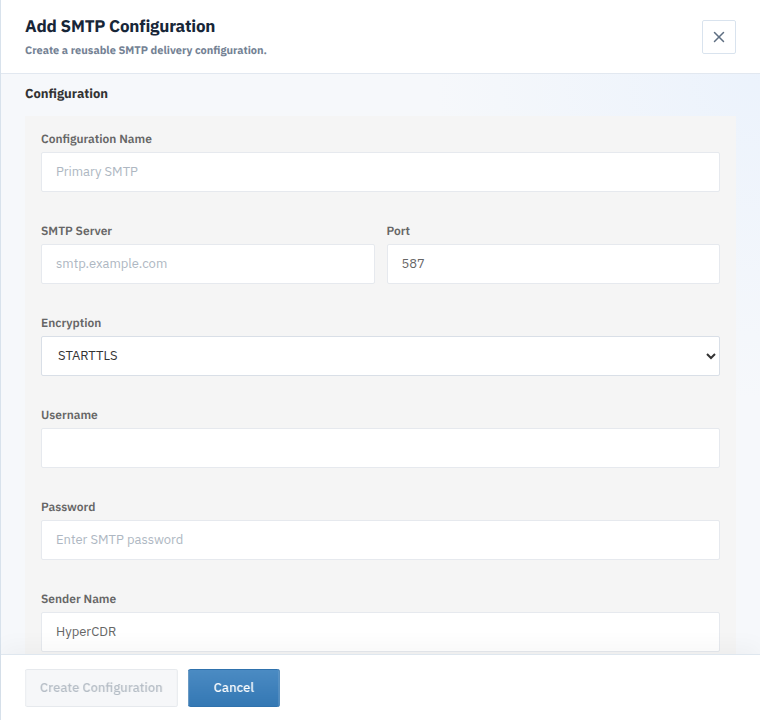

截图为未填写的创建窗口局部；下方的 Sender Email 等字段可在窗口内滚动查看。图中的 `587` 和 STARTTLS 是表单初始值，不代替邮件服务商要求。

#### 前置条件

- 使用平台管理员账号，准备邮件服务器地址、端口、加密方式、认证信息和获准使用的发件地址。
- 中控能访问邮件服务器，准备一个可接收测试邮件的真实邮箱。
- 平台公开地址正确，否则收到的邀请或恢复密码链接可能无法访问。

#### 操作步骤

1. 进入 **Settings → Email Service**，点击 **New**。
2. 填写配置名称、SMTP Server、Port、Encryption、Username、Password、Sender Name 和 Sender Email。
3. 点击 **Create Configuration** 保存。选择该配置，通过 **More → Test** 输入收件邮箱并发送测试邮件。
4. 检查列表 **Test Status** 和收件箱；未收到时同时检查垃圾箱和邮件服务商投递记录。
5. 需要将该配置用于默认投递时，选择 **More → Set as Default**，确认列表默认标识。切换默认配置前先完成投递验证。

#### 字段与页面说明

| 字段 | 说明 |
| --- | --- |
| Configuration Name | 便于识别用途的名称，不是服务器域名 |
| SMTP Server / Port | 邮件服务商提供的主机与端口，必须与加密方式匹配 |
| Encryption | STARTTLS、TLS 或 None；生产环境优先采用服务商支持的加密连接 |
| Username / Password | SMTP 认证信息，可能需要专用授权码；不要使用示例凭据 |
| Sender Name / Sender Email | 收件人看到的发件身份，需满足邮件服务商的授权规则 |
| Test Status | Not tested、Succeeded 或 Failed，反映最近测试结果 |
| Default | 默认投递配置；不是单纯的列表排序标识 |

#### 结果确认

测试状态成功且目标邮箱收到邮件，默认配置标识符合预期；再按需要验证邀请或密码恢复邮件中的链接指向正确平台地址。

#### 注意事项与常见问题

- 保存成功不等于已验证投递。测试成功也不能保证所有收件域均不会拦截邮件。
- 默认配置不能直接删除；先准备并验证替代配置，再切换默认项。
- 邮件失败优先检查 DNS、出站端口、TLS、认证和发件地址授权，不要在截图中展示密码。

### 13.3 平台访问地址与登录配置

#### 功能说明

**Access & Sign-in** 管理用于生成验证、邀请、密码恢复链接和 Google 登录回调的平台地址。它不是自动配置 DNS、证书或外部代理的工具。

#### 前置条件

使用平台管理员账号；新的 HTTPS 地址、DNS、证书和入口网络已经准备好，并已评估现有集群连接配置。

#### 操作步骤

1. 进入 **Settings → Access & Sign-in**，检查 **Configured URL** 是否与预期地址一致。
2. 需要变更时点击 **Change address**，按页面要求输入并确认新地址。不要在网络和证书未准备好时先保存。
3. 刷新并核对地址；展开生成的邮件链接示例，检查链接使用的新地址。
4. 如需 Google 登录，由部署管理员在服务端成对配置 Client ID 和 Secret；将页面显示的完整 **Authorized redirect URI** 登记到 Google Cloud Console。
5. 用受控账号验证邮件链接和启用的登录方式，并检查现有 Agent 连接，不要只确认设置保存成功。

#### 字段与页面说明

| 信息 | 说明 |
| --- | --- |
| Configured URL | 平台用于生成链接的公开 HTTPS 地址 |
| 地址匹配提示 | 对比当前浏览器地址与配置地址，不代表外部网络已全部验证 |
| Google sign-in | 显示服务端是否已配置 Google 登录 |
| Authorized redirect URI | 必须在 Google 侧精确匹配的回调地址，包含路径 |

#### 结果确认

生成的链接可访问，登录方式符合预期，现有集群连接正常。Google 登录需要受支持的域名和一致的 OAuth 配置，不能将私网 IP 直接作为 Web 回调地址。

#### 注意事项与常见问题

修改公开地址不会自动替用户安装证书、配置 DNS 或登记 Cloudflare 允许清单。验证码模式仍以部署配置为准，不能把本页面理解为 Turnstile 与图片验证码的自动切换开关。

### 13.4 个人资料与密码

#### 功能说明

个人资料用于维护显示名称和绑定邮箱，**Sign-in & Security** 用于管理密码及已连接的登录方式。

#### 前置条件

当前账号已登录；修改密码前准备当前密码，绑定邮箱前确认邮箱可接收验证邮件且平台邮件服务可用。

#### 操作步骤

1. 打开 **Settings → Personal Information**，核对登录账号、组织、角色和绑定邮箱。
2. 点击 **Edit profile** 修改显示名称；绑定邮箱使用个人资料页提供的邮箱操作，不在平台用户编辑窗口修改。
3. 打开 **Settings → Sign-in & Security**，点击 **Change password**，按页面要求输入并确认新密码。
4. 按页面提示完成邮箱验证或重新登录，确认更新结果。不要为截图修改真实账号密码。

#### 字段与页面说明

| 信息 | 说明 |
| --- | --- |
| Name | 组织内显示名称，与登录账号不同 |
| Login account | 当前登录身份，不因修改显示名称而改变 |
| Bound email | 用于密码恢复等邮件，未绑定时需先完成绑定验证 |
| Organization / Role | 当前所属组织和权限身份，不能通过个人资料跨组织切换 |
| Password | 页面提示使用至少 8 位的独立密码，不与其他服务共用 |

#### 结果确认

资料显示更新后的值，邮箱完成验证，密码变更按提示生效；检查仍可通过预期登录方式访问平台。

#### 注意事项与常见问题

未配置 Google 登录时，个人安全页会显示未配置提示，不代表账号异常。账号密码、邮箱验证码和恢复链接均不得发布到文档或工单。

## 14. 常见问题

| 问题 | 处理建议 |
| --- | --- |
| Agent offline | 检查 WSS 出站、证书、Token、Agent Pod 和网络策略 |
| 存储测试失败 | 检查 endpoint、Bucket、区域、凭据、TLS 和集群网络 |
| 没有恢复点 | 检查保护配置是否激活、同步任务是否完成及详细日志 |
| Drill 失败 | 检查隔离 Namespace、目标权限、PVC/CSI、容量和资源冲突 |
| Restore 失败 | 先看第一个失败阶段，再检查目标 RBAC、Velero/OADP 和对象存储 |
| 邮件未发送 | 检查 SMTP 配置和测试邮件结果 |

## 15. 页面截图说明

本文使用 HyperCDR 实机页面配合操作步骤，包含登录、集群类型、存储配置、策略配置、应用保护阶段、恢复点、Drill 目标、恢复就绪详情、任务摘要和任务事件。截图中的名称、时间和数量仅为示例，不代表推荐配置或产品限制；部分图片为突出当前步骤而截取的局部页面。

| 页面 | 图片目录 |
| --- | --- |
| 集群注册 | `docs/assets/images/user-guide/` |
| 存储和策略 | `docs/assets/images/user-guide/` |
| 保护、恢复点和任务 | `docs/assets/images/user-guide/` |

不同版本的布局和可见字段可能略有差异，请以安装版本和当前账号权限为准。与支持人员分享自己的截图时，请隐藏 Token、密码、kubeconfig、密钥和敏感环境信息。

## 16. 发布版本说明

本手册只描述当前 HyperCDR 社区版已验证的功能。发布新版本时，应同步更新页面名称、字段、截图和兼容性说明。
